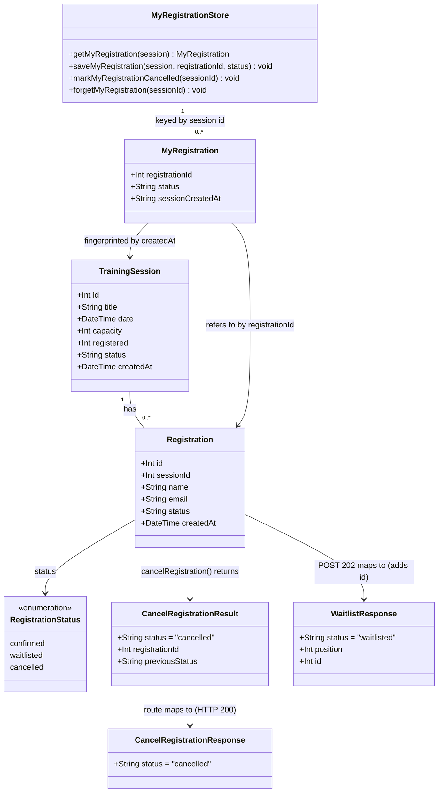

# Employee Cancels a Training Session Registration (WH-4)

## Requirements

- Let an employee release their place in a training session by cancelling the registration they hold, identified only by its registration ID (no authentication, by design for training).
- Keep the session's seat accounting truthful: a cancelled confirmed registration frees exactly one seat, a cancelled waitlisted registration frees none, and cancelled registrations never count towards capacity or waitlist positions.
- Make cancellation safe to repeat: a second cancel is a clear conflict, never a second decrement, even when two requests race.
- Prepare, without implementing, the hand-off to WH-5: the freed seat passes through a single promotion step inside the same transaction.
- Give the employee a way back to their registration after a page reload, so the "Cancel Registration" control survives the refresh it triggers.
- Scope: one new API endpoint, one additive field on WH-3's waitlist response, and the session card UI. Out of scope: cancellation emails (WH-8), organiser-initiated cancellation, authentication, and the promotion behaviour itself (WH-5).

## Entities

Notes:

- `TrainingSession` and `Registration` are unchanged in the Prisma schema. The `cancelled` status value already exists in the schema comment and `REGISTRATION_STATUS`. No migration and no `db push` are needed.
- `CancelRegistrationResult` is the service-layer return type; `CancelRegistrationResponse` is the HTTP body. WH-5 will add `promotedRegistrationId` to both, additively.
- `WaitlistResponse` gains `id` (additive). Existing WH-3 tests assert it with `expect.objectContaining`, so they keep passing.
- `MyRegistration` and `MyRegistrationStore` are frontend-only and live in browser `localStorage`. `sessionCreatedAt` invalidates saved entries after the database is reseeded.

## Approach

1. **API design: one soft-cancel endpoint**
   - `DELETE /api/training-sessions/:id/registrations/:registrationId`. The verb and path are fixed by the acceptance criteria.
   - Cancellation is a status change (`confirmed | waitlisted → cancelled`), never a row delete. History is kept for WH-6 (organiser view) and WH-9 (audit log), and a repeat cancel can be told apart (409) from an unknown ID (404).
   - Status codes:
     - 200 `{ status: "cancelled" }` on success.
     - 404 `{ error: "Registration not found" }` when the ID is unknown, belongs to a different session, or either path segment isn't a positive integer. Non-numeric IDs return 404 to match the sibling `POST /:id/registrations`.
     - 409 `{ error: "Registration is already cancelled" }`.
     - 500 `{ error: "Failed to cancel registration" }` for unexpected errors.
   - WH-3's 202 response gains the registration `id` so a waitlisted employee can cancel too.

2. **Technical implementation: same shape as WH-3**
   - Thin Express route → service function → one Prisma interactive transaction (`prisma.$transaction(async (tx) => …)`).
   - The service signals business errors by throwing the existing `{ status, error }` objects. The route narrows them with `as { status?: number; error?: string }` and maps them to HTTP. The project has no global exception handler; this per-route mapping is the established convention and stays.
   - Race safety comes from the database, not from read-then-write. The status flip is an `updateMany` conditioned on the status the transaction just read. If another request changed it first, `count` is 0 and the request becomes a 409. This mirrors WH-3's conditional `registered` increment.
   - The counter decrement is conditioned on `registered > 0`, so drifted data can never push it negative.
   - The WH-5 seam is a private service function `promoteFromWaitlist(tx, sessionId)`. It's called inside the transaction only when a confirmed seat was freed, and in WH-4 it returns `null` without touching the database.

3. **Business logic**
   - Only `confirmed` and `waitlisted` registrations can be cancelled; `cancelled` is terminal.
   - Cancelling `confirmed` decrements `registered` by exactly 1 and calls the promotion step. Cancelling `waitlisted` leaves `registered` alone. Positions behind it close up automatically, because positions are derived only from `waitlisted` rows.
   - The registration must belong to the session in the URL; otherwise it's 404. The wrong session's counter is never touched.

4. **Frontend: card-level cancel with persistent "my registration"**
   - A small `localStorage` module remembers, per session ID, the registration this browser created, its last known status, and the session's `createdAt`.
   - An entry whose `sessionCreatedAt` doesn't match the session now served by the API is discarded. Reseeding recreates sessions with new `createdAt` values, so stale IDs from a previous database can't cancel someone else's registration.
   - The session card shows "Cancel Registration" only when the saved entry is `confirmed`, and a disabled "Cancelled" button when it's `cancelled` (AC 5). Nothing is shown for `waitlisted`: the API allows it, but the UI follows AC 1.
   - Confirmation is an inline step in the card, so the exact prompt text is in the DOM: "Are you sure you want to cancel your registration for [Session Title]?" with "Yes, cancel registration" and "Keep my registration". Those labels deliberately avoid the bare "Cancel" already used by the registration form.
   - After a successful DELETE, the card shows "Your registration has been cancelled" and calls the existing page refetch, so the capacity line ("11 / 20 registered (9 spots left)") comes from the server.

5. **Testing strategy**
   - One integration test file per API acceptance criterion and clarification, named `api/tests/integration/wh4-*.test.ts`. They use Jest + Supertest against the shared dev SQLite DB, with WH-3's isolation pattern: per-file `test-wh4-<name>-` email prefix, `afterEach` deletes those rows and restores every counter it changed.
   - Unit tests for `cancelRegistration` in the existing service unit test file, with the mocked Prisma client and a mocked transaction client.
   - The app has no test runner. UI acceptance criteria are verified manually with `make dev`, following steps listed in Safeguards.

## Structure

### Inheritance Relationships

1. No class hierarchy. The codebase is functional TypeScript; services are modules of exported async functions, and errors are plain `{ status: number; error: string }` objects, not `Error` subclasses.
2. `CancelRegistrationResult` is a TypeScript type exported from `trainingSessionService.ts`, alongside the existing `RegistrationResult`.
3. `MyRegistration` is a TypeScript interface in `app/src/types/index.ts`; `MyRegistrationStore` is a module of exported functions in `app/src/lib/myRegistrations.ts`.

### Dependencies

1. `routes/training-sessions.ts` calls `cancelRegistration` from `services/trainingSessionService.ts`. It doesn't use Prisma for the new endpoint.
2. `cancelRegistration` depends on the shared Prisma client from `lib/prisma.ts` and runs everything through `prisma.$transaction`.
3. `cancelRegistration` calls the private `promoteFromWaitlist(tx, sessionId)` with the same transaction client `tx`.
4. `TrainingSessionCard.tsx` calls `fetch` for `POST` and `DELETE` and uses `lib/myRegistrations.ts` for persistence.
5. `TrainingSessionsPage.tsx` passes the existing refetch callback to the card. Its behaviour is unchanged.

### Layered Architecture

1. **Route layer** (`api/src/routes/training-sessions.ts`): parses and validates path parameters, calls the service, maps results and thrown `{ status, error }` objects to HTTP. No business rules, no Prisma.
2. **Service layer** (`api/src/services/trainingSessionService.ts`): ownership and state checks, conditional status transition, counter maintenance, promotion seam, transaction boundary.
3. **Data access**: the Prisma client (`api/src/lib/prisma.ts`) over SQLite. There's no repository layer in this codebase, and none is introduced.
4. **Error handling**: per-route `try/catch` that narrows `unknown` to `{ status?: number; error?: string }`. Unexpected errors are logged with `console.error` and become a generic 500.
5. **Frontend**: the page owns data fetching; the card owns per-session interaction state; `lib/myRegistrations.ts` owns browser persistence and its failure handling.

## Operations

### Update Service - `cancelRegistration` in `api/src/services/trainingSessionService.ts`

1. Responsibility: cancel one registration of one session atomically, keeping `registered` truthful, and call the promotion step when a confirmed seat is freed.
2. Types to add (exported, next to `RegistrationResult`):
   - `export type CancelRegistrationResult = { status: 'cancelled'; registrationId: number; previousStatus: 'confirmed' | 'waitlisted' }`
3. Imports: add `Prisma` to the existing `@prisma/client` type import so the transaction client can be typed as `Prisma.TransactionClient`.
4. Methods:
   - `promoteFromWaitlist(_tx: Prisma.TransactionClient, _sessionId: number): Promise<number | null>`. This is module-private, not exported.
     - Logic: return `null`. Put a one-line comment above it saying WH-5 implements promotion here, inside the cancellation transaction, and returns the promoted registration's ID. The underscore-prefixed parameters satisfy the lint rule `argsIgnorePattern: '^_'`.
   - `export async function cancelRegistration(sessionId: number, registrationId: number): Promise<CancelRegistrationResult>`
     - Logic: run all of the following inside `prisma.$transaction(async (tx): Promise<CancelRegistrationResult> => { … })`:
       1. `const existing = await tx.registration.findFirst({ where: { id: registrationId, sessionId }, select: { status: true } })`.
       2. If `existing` is `null`, `throw { status: 404, error: 'Registration not found' }`. This covers unknown IDs, IDs from another session, and sessions that don't exist.
       3. If `existing.status === REGISTRATION_STATUS.cancelled`, `throw { status: 409, error: 'Registration is already cancelled' }`.
       4. Narrow `existing.status` to `'confirmed' | 'waitlisted'`. Any other stored value is unexpected: `throw { status: 409, error: 'Registration cannot be cancelled' }`.
       5. `const flipped = await tx.registration.updateMany({ where: { id: registrationId, sessionId, status: previousStatus }, data: { status: REGISTRATION_STATUS.cancelled } })`.
       6. If `flipped.count === 0`, another request changed the row after step 1: `throw { status: 409, error: 'Registration is already cancelled' }`.
       7. If `previousStatus === REGISTRATION_STATUS.confirmed`:
          - `await tx.trainingSession.updateMany({ where: { id: sessionId, registered: { gt: 0 } }, data: { registered: { decrement: 1 } } })`
          - `await promoteFromWaitlist(tx, sessionId)` (the return value is ignored in WH-4)
       8. Return `{ status: 'cancelled', registrationId, previousStatus }`.
     - Exception handling: only `{ status, error }` objects are thrown deliberately. Prisma errors propagate unchanged and become 500 in the route. A throw inside the callback rolls the whole transaction back.
5. Constraints: no input parsing here (the route guarantees positive integers); no Prisma use outside the transaction; don't change `createRegistration`, `getAllSessions` or `getSessionById`.

### Update Route - add `DELETE /:id/registrations/:registrationId` in `api/src/routes/training-sessions.ts`

1. Responsibility: HTTP mapping only.
2. Imports: add `cancelRegistration` to the existing import from `../services/trainingSessionService`. Don't add or use any Prisma import for this route.
3. Handler `router.delete('/:id/registrations/:registrationId', async (req: Request, res: Response) => { … })`, declared after the POST handler:
   - Parse both params with a small module-level helper `parsePositiveInt(value: string): number | null`. It returns `null` unless `value` matches `/^[1-9]\d*$/` and the number is ≤ `Number.MAX_SAFE_INTEGER`.
   - If either param is `null`: `res.status(404).json({ error: 'Registration not found' })` and return.
   - `try`: `await cancelRegistration(sessionId, registrationId)`, then `res.status(200).json({ status: 'cancelled' })`.
   - `catch (error)`: `const err = error as { status?: number; error?: string }`. If `typeof err.status === 'number'`, `res.status(err.status).json({ error: err.error })`. Otherwise `console.error('Error cancelling registration:', error)` and `res.status(500).json({ error: 'Failed to cancel registration' })`.
4. Update the existing POST handler's 202 branch to `res.status(202).json({ status: result.status, position: result.position, id: result.registration.id })`. Nothing else in the POST handler changes.

### Update Frontend Types - `app/src/types/index.ts`

1. Add `id: number` to `WaitlistResponse`.
2. Add:
   - `export interface MyRegistration { registrationId: number; status: RegistrationStatus; sessionCreatedAt: string }`
   - `export interface CancelRegistrationResponse { status: 'cancelled' }`

### Create Frontend Module - `app/src/lib/myRegistrations.ts`

1. Responsibility: persist, per session, the registration this browser created, and never let storage failures break the page.
2. Constants: `const STORAGE_KEY = 'workshophub.myRegistrations.v1'`. The stored value is a JSON object `Record<string, MyRegistration>` keyed by session ID.
3. Private helpers:
   - `readAll(): Record<string, MyRegistration>`: `try` `JSON.parse(localStorage.getItem(STORAGE_KEY) ?? '{}')`. Keep only entries where `registrationId` is a number, `status` is one of the three statuses, and `sessionCreatedAt` is a string. Return `{}` on any exception or non-object value.
   - `writeAll(all: Record<string, MyRegistration>): void`: `try` `localStorage.setItem(STORAGE_KEY, JSON.stringify(all))`; swallow exceptions (private mode, quota).
4. Exported functions:
   - `getMyRegistration(session: TrainingSession): MyRegistration | null`: read the entry for `String(session.id)`. If it exists but `entry.sessionCreatedAt !== session.createdAt`, delete it, write back, and return `null` (reseed guard). Otherwise return the entry or `null`.
   - `saveMyRegistration(session: TrainingSession, registrationId: number, status: RegistrationStatus): void`: overwrite the session's entry with `{ registrationId, status, sessionCreatedAt: session.createdAt }`. The most recent registration wins when the same browser registers twice.
   - `markMyRegistrationCancelled(sessionId: number): void`: set `status` to `'cancelled'` if an entry exists.
   - `forgetMyRegistration(sessionId: number): void`: delete the entry if present.
5. Constraints: no `any`; validate parsed JSON with type guards; no other module touches `localStorage` for this key.

### Update Component - `app/src/components/TrainingSessionCard.tsx`

1. Responsibility: add the cancel flow next to the existing register flow without changing the register flow's behaviour.
2. State to add:
   - `myRegistration: MyRegistration | null`, initialised with `useState(() => getMyRegistration(session))`. Re-sync with `useEffect(() => setMyRegistration(getMyRegistration(session)), [session])` so a refetch with new session data re-checks the reseed guard.
   - `confirmingCancel: boolean` (default `false`).
   - `cancelling: boolean` (default `false`).
3. Register flow changes in `handleSubmit`:
   - 201: after parsing `Registration`, call `saveMyRegistration(session, body.id, 'confirmed')` and `setMyRegistration(getMyRegistration(session))`.
   - 202: after parsing `WaitlistResponse`, call `saveMyRegistration(session, body.id, 'waitlisted')` and refresh `myRegistration` the same way.
   - Messages and the existing refetch call are unchanged.
4. New method `handleConfirmCancel(): Promise<void>`:
   - Guard: return if `cancelling` is true or `myRegistration` is `null`. Set `cancelling` true and clear `formError` and `successMessage`.
   - `fetch(`${API_BASE}/api/training-sessions/${session.id}/registrations/${myRegistration.registrationId}`, { method: 'DELETE' })`.
   - 200: `markMyRegistrationCancelled(session.id)`, refresh `myRegistration`, `setSuccessMessage('Your registration has been cancelled')`, `setConfirmingCancel(false)`, call `onRegistered()` so the capacity line refreshes.
   - 409: `markMyRegistrationCancelled(session.id)`, refresh `myRegistration`, `setSuccessMessage('This registration was already cancelled')`, `setConfirmingCancel(false)`.
   - 404: `forgetMyRegistration(session.id)`, refresh `myRegistration`, `setFormError('We could not find that registration. It may have been removed.')`, `setConfirmingCancel(false)`.
   - Any other status or a network error: `setFormError('Something went wrong. Please try again.')` and keep the confirm step open.
   - `finally`: `setCancelling(false)`.
5. Rendering, inside `.session-card__registration` and after the existing success/error messages, before the register form/button:
   - If `myRegistration?.status === 'confirmed'` and not `confirmingCancel`: a `button` with class `session-card__cancel-registration` and text "Cancel Registration"; `onClick` sets `confirmingCancel` true and clears `successMessage`.
   - If `confirmingCancel`: a `div` with `role="alertdialog"` and class `session-card__confirm`, containing a `p` with `Are you sure you want to cancel your registration for {session.title}?` and two buttons: "Yes, cancel registration" (calls `handleConfirmCancel`; disabled and reading "Cancelling..." while `cancelling`) and "Keep my registration" (sets `confirmingCancel` false).
   - If `myRegistration?.status === 'cancelled'`: a disabled `button` with class `session-card__cancel-registration` and text "Cancelled".
   - No cancel control for `waitlisted` (AC 1).
   - The existing Register / Join Waitlist form and button render exactly as today.
6. Constraints: no `any`; typed `res.json()` casts as in the existing code; keep the existing form's "Cancel" button and its behaviour unchanged.

### Update Styles - `app/src/components/TrainingSessionCard.css`

1. Add `.session-card__cancel-registration` (a secondary, outlined button that's visually distinct from the primary Register button, with a muted disabled state) and `.session-card__confirm` (a bordered inline panel with spacing for its prompt and two buttons), reusing the colours and radii already used by `.session-card__register` and `.session-card__error`.

### Create Integration Tests - `api/tests/integration/wh4-*.test.ts`

Shared pattern for every file:

- `import request from 'supertest'`, `app`, `prisma`.
- Per-file `TEST_EMAIL_PREFIX = 'test-wh4-<file-suffix>-'`.
- Record every touched session's original `registered` before acting; `afterEach` restores it and deletes the file's `test-wh4-…` registrations; `afterAll` disconnects.
- Pick sessions through `GET /api/training-sessions` (non-full: `registered < capacity`; full: `registered >= capacity`), and create registrations through the public `POST` endpoint, never directly through Prisma, except when reading back state for assertions.

Files:

1. `wh4-cancel-returns-200.test.ts`, for AC 6. Register on a non-full session (201), `DELETE` it, and expect 200 with body exactly `{ status: 'cancelled' }`.
2. `wh4-cancelled-status-in-db.test.ts`, for AC 7. After a successful cancel, `prisma.registration.findUnique` returns the row with `status: 'cancelled'`, and the row still exists.
3. `wh4-registered-decrements.test.ts`, for AC 8:
   - Cancelling a confirmed registration makes `GET /api/training-sessions/:id` report `registered` one lower than right after registering.
   - Cancelling a waitlisted registration on a full session leaves `registered` unchanged.
4. `wh4-not-found-404.test.ts`, for AC 9:
   - 404 for an unknown registration ID (`999999`).
   - 404 for a real registration ID used under a different session ID.
   - 404 for a non-numeric registration ID (`abc`).
   - 404 for a non-numeric session ID.
   - Every case has an `error` string in the body.
5. `wh4-already-cancelled-409.test.ts`, for AC 10:
   - The second `DELETE` of the same registration returns 409 with an `error` string.
   - `registered` decreased by exactly 1 overall.
6. `wh4-waitlisted-cancel.test.ts`, for Clarification 1:
   - On a full session, the 202 body includes a numeric `id`.
   - Two waitlisted registrations A then B; cancelling A returns 200 and leaves `registered` unchanged.
   - A third waitlisted registration C now gets `position` equal to B's original position (one place freed).

### Update Unit Tests - `api/tests/unit/trainingSessionService.test.ts`

1. Extend the `jest.mock` of `../../src/lib/prisma` with `registration.findFirst` and `registration.updateMany`. `trainingSession.updateMany` is already mocked.
2. Add a `describe('cancelRegistration')` block, with `$transaction` mocked to call the callback with a `tx` object containing those mocks:
   - Confirmed: resolves to `{ status: 'cancelled', registrationId, previousStatus: 'confirmed' }`; `registration.updateMany` is called with a `where` that includes `status: 'confirmed'`; `trainingSession.updateMany` is called with `where: { id, registered: { gt: 0 } }` and `data: { registered: { decrement: 1 } }`.
   - Waitlisted: resolves with `previousStatus: 'waitlisted'`; `trainingSession.updateMany` is not called.
   - Not found (`findFirst` resolves `null`): rejects with `{ status: 404, error: 'Registration not found' }`.
   - Already cancelled: rejects with `{ status: 409, error: 'Registration is already cancelled' }`; `registration.updateMany` is not called.
   - Lost race (`updateMany` resolves `{ count: 0 }`): rejects with 409; the counter isn't touched.

### Update Story File - `stories/wh-4-cancel-registration.md`

1. Tick each acceptance criterion once its test or manual check passes. Leave AC 11 unticked, with a note that WH-4 delivers only the promotion step and WH-5 completes it.

### Execution Order

1. Write the integration and unit tests (RED); run `make test` and confirm the new tests fail for the expected reason (404 route missing, `cancelRegistration` not exported, 202 body without `id`).
2. Service: `CancelRegistrationResult`, `promoteFromWaitlist`, `cancelRegistration`.
3. Route: `DELETE` handler and the 202 `id`.
4. `make test` until green.
5. Frontend: types → `lib/myRegistrations.ts` → card → CSS.
6. `make lint` and `make format-check`; then the manual UI checks from Safeguards.
7. Update the story file.

## Norms

1. **Layering**: routes do HTTP only; all database access lives in `trainingSessionService.ts`. The new route must not reference Prisma. The pre-existing `/search` route's Prisma use is a deliberate Workshop 8 exercise and stays untouched.
2. **Typing**: no `any`, including `as any`. Narrow caught errors from `unknown` with `as { status?: number; error?: string }` exactly as the existing POST handler does. Type the transaction client as `Prisma.TransactionClient`. Type parsed `localStorage` data with type guards, not casts.
3. **Error contract**: business errors are thrown as `{ status: number; error: string }` and returned to clients as `{ error: string }` with that status. Messages are fixed strings:
   - `Registration not found`
   - `Registration is already cancelled`
   - `Registration cannot be cancelled`
   - `Failed to cancel registration`

   They never include stack traces, SQL or Prisma error text.

4. **Status values**: use `REGISTRATION_STATUS.confirmed`, `.waitlisted` and `.cancelled` from the service, never string literals, in API code.
5. **Transactions**: every multi-step state change runs in a single `prisma.$transaction` callback, and conditional writes (`updateMany` with a guard in `where`) decide races.
6. **Logging**: `console.error('Error cancelling registration:', error)` for unexpected errors only; business outcomes (404/409) aren't logged.
7. **Comments**: only where intent isn't obvious, matching the existing density: the conditional status flip, the `registered > 0` guard, the WH-5 seam, and the reseed guard in `getMyRegistration`.
8. **Formatting and lint**: Prettier and ESLint as configured. The `prettier_on_write` hook formats edited files. `make lint` and `make format-check` must pass with no rules disabled.
9. **Tests**: Jest + Supertest; one integration file per acceptance criterion with the `wh4-` prefix; a per-file `test-wh4-…-` email prefix; restore every counter in `afterEach`; `maxWorkers: 1` stays. Integration test names start with the criterion they prove, `WH-4 AC <n>: …` (or `WH-4 Clarification <n>: …`), so every test traces back to the story.

## Safeguards

1. **Functional constraints**:
   - `DELETE` returns 200 `{ status: "cancelled" }` exactly once per registration; every later call for it returns 409.
   - Cancelling a confirmed registration reduces `registered` by exactly 1. Cancelling a waitlisted one leaves it unchanged.
   - `promoteFromWaitlist` is called only after a confirmed cancellation, and in WH-4 it makes no database writes.
2. **Performance constraints**: a cancellation is one transaction of at most 3 statements in WH-4 (`findFirst`, `updateMany` on the registration, `updateMany` on the session). No extra queries are added to `GET` endpoints.
3. **Security constraints**:
   - **Accepted risk (training scope):** there's no authentication, so anyone who knows or guesses a sequential registration ID and its session ID can cancel it. Requiring both IDs to match narrows this, but doesn't fix it. Real deployments would need an unguessable cancel token or authenticated ownership. This is expected to come up again in the Workshop 8 security exercises, and must not be "fixed" in WH-4 by inventing auth.
   - Browser storage holds only the registration ID, its status and the session's `createdAt`, never name or email.
   - The reseed guard (`sessionCreatedAt` must match) stops IDs saved against an earlier database from cancelling a different person's registration after `make reset-db` or `make seed`.
4. **Integration constraints**:
   - WH-3's 202 body changes additively (`id`), and existing WH-3 tests must stay green unchanged.
   - WH-5 must be able to implement promotion by changing only `promoteFromWaitlist` and extending `CancelRegistrationResult` and the 200 body. WH-4 must not hard-code anything that blocks this, such as an exact-match assertion on the 200 body outside `wh4-cancel-returns-200.test.ts`.
5. **Business rule constraints**:
   - A registration can be cancelled only through the session it belongs to.
   - `cancelled` is terminal: no endpoint or code path moves a registration out of `cancelled`.
   - Cancelled registrations never count towards `registered`, the derived `waitlisted` count, or waitlist positions.
   - `registered` never goes below 0.
6. **Exception handling constraints**:
   - Deliberate errors carry a fixed message and the HTTP status (404, 409) as their code.
   - Errors are classified by cause: not found (404), state conflict (409), unexpected (500).
   - Responses never expose internal details.
   - All errors for the new endpoint are handled in its route `catch`. The project has no global handler, and none is added.
7. **Technical constraints**:
   - No schema change, no migration, no new dependencies in `api/` or `app/`.
   - No direct `localStorage` access outside `app/src/lib/myRegistrations.ts`.
   - No `window.confirm`.
   - Integration tests must leave the shared dev DB as they found it, even when an assertion fails (restore in `afterEach`, not at the end of the test body).
8. **Data constraints**:
   - Path parameters must match `^[1-9]\d*$` and be ≤ `Number.MAX_SAFE_INTEGER`; anything else is 404.
   - Saved browser entries failing validation are ignored.
   - Rows are never deleted by cancellation.
9. **API constraints**:
   - `DELETE /api/training-sessions/:id/registrations/:registrationId`
     - 200 `{ status: "cancelled" }`
     - 404 `{ error: "Registration not found" }`
     - 409 `{ error: "Registration is already cancelled" }` or `{ error: "Registration cannot be cancelled" }`
     - 500 `{ error: "Failed to cancel registration" }`
   - `POST /api/training-sessions/:id/registrations`: 202 body is `{ status: "waitlisted", position: number, id: number }`; 201 is unchanged.
10. **Manual UI verification** (`make dev`, http://localhost:5173), all required before ticking the UI acceptance criteria:
    - Register on a session with space; "Cancel Registration" appears and survives a page reload.
    - Click it; the inline prompt reads "Are you sure you want to cancel your registration for [title]?"
    - "Keep my registration" closes it with no request sent.
    - "Yes, cancel registration" shows "Your registration has been cancelled", and the capacity line drops by one with the spots-left text updated.
    - Reload; the button reads "Cancelled" and is disabled.
    - Join a waitlist on a full session; no cancel control appears.
    - Run `make reset-db`, then reload; no stale cancel control appears.
