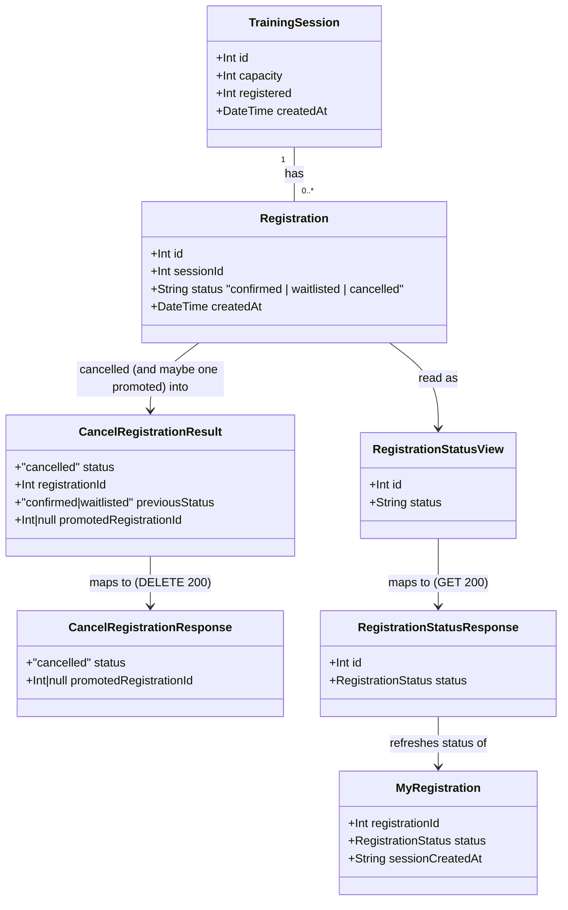

# WH-5: Promote the first waitlisted employee after a cancellation

## Requirements

- Give a freed seat straight to the next person waiting: when a **confirmed** registration is cancelled, promote the session's earliest **waitlisted** registration (by `createdAt`, then `id`) to `confirmed` in the same transaction, so the seat is never empty and `registered` doesn't change.
- Keep WH-4's behaviour everywhere else: with nobody waitlisted, `registered` drops by 1; cancelling a waitlisted registration never promotes anyone and never changes `registered`.
- Tell the caller who was promoted: the cancellation response always includes `promotedRegistrationId` (a number or `null`). That's also the hand-off point for WH-8's notification, which stays out of scope.
- Let a promoted employee see it on their next visit: add a read-only status lookup for one registration, and have the session card show the viewer's own registration as "Confirmed" or "Waitlisted", refreshed from the server on every page load.
- Scope: one service change (filling in WH-4's promotion step), one new service read, one new GET route, one extra field on the DELETE response, and the session card's status label and refresh. Out of scope: notifications (WH-8), the audit log (WH-9), the organiser view (WH-6), cancellation tokens (WH-12), polling or push updates, showing waitlist position, and a Cancel button for waitlisted employees.
- **Decisions to review** (made in this canvas; nobody has approved them yet):
  1. **Seat transfer.** When someone is promoted, the decrement is skipped, rather than "−1 then +1" as the card's wording suggests. The outcome is the same: `registered` is unchanged.
  2. **Retry on a lost promotion race.** If the conditional flip of the first candidate matches nothing, try the next candidate, at most 3 times. If all 3 fail, decrement instead, as if nobody had been waitlisted.
  3. **Label text.** The label reads `Your registration: Confirmed` or `Your registration: Waitlisted`. Cancelled keeps WH-4's disabled "Cancelled" button and shows no label.
  4. **No Cancel button for waitlisted employees** in WH-5. The API allows it since WH-4, but the UI doesn't show it.

## Entities

- No schema change. The waitlist is still the session's `waitlisted` registrations, ordered by `createdAt` then `id`, the same order WH-3 uses for positions.
- `CancelRegistrationResult` (API) and `CancelRegistrationResponse` (app) each gain one field, `promotedRegistrationId`, as WH-4 planned. It's always present, and `null` when nobody was promoted, including every waitlisted cancellation.
- `RegistrationStatusView` (API service) and `RegistrationStatusResponse` (app) are new. They carry the ID and the status only, never the name or email.
- `MyRegistration` (browser storage, WH-4) is unchanged. Only its `status` value gets refreshed.

## Approach

1. **Promotion inside the cancellation (backend)**:
   - Fill in WH-4's private `promoteFromWaitlist(tx, sessionId)`. It runs inside the existing `$transaction`, only after a **confirmed** registration has been flipped to `cancelled`.
   - **Seat transfer:** if a candidate is promoted, `registered` isn't touched. Only when `promoteFromWaitlist` returns `null` does `cancelRegistration` do WH-4's guarded decrement. That makes "the freed seat goes straight to the next person" true by construction, with no moment when the seat looks free to a concurrent registration. The card's "−1 and +1 = net zero" outcome is met.
   - **Waitlist order** is defined once, as a module constant `WAITLIST_ORDER` (`createdAt` ascending, then `id` ascending), and used by promotion. WH-3's position count already encodes the same order, and a comment ties the two together.
   - **Conditional flip:** a candidate becomes `confirmed` only through `updateMany` with `status: 'waitlisted'` in the `where` clause, the pattern WH-3 and WH-4 already use. If it matches nothing, the candidate changed concurrently, so try the next one, at most `MAX_PROMOTION_ATTEMPTS = 3`. If all attempts fail, return `null`, so the seat is released by the decrement instead. Under SQLite's serialized writes this path is practically unreachable, but it must still be correct.
   - **Atomicity:** every read and write uses the transaction client `tx`. Any error thrown inside promotion rejects the whole transaction, including the cancellation.

2. **Status lookup (API)**:
   - New service read `getRegistrationStatus(sessionId, registrationId)`. It returns `{ id, status }` for a registration in that session, or `null` if there isn't one.
   - New route `GET /api/training-sessions/:id/registrations/:registrationId`. It follows WH-4's DELETE contract: `parsePositiveInt` for both IDs, and any malformed, unknown or other-session ID returns 404 `{ error: "Registration not found" }`. Success returns 200 `{ id, status }`.
   - The route stays thin (CLAUDE.md norm 2): parse IDs, call the service, map the result to HTTP. Unexpected errors are logged and return 500 `{ error: "Failed to fetch registration" }`.
   - Security: this has the same ID-as-identity model as WH-4, and is accepted for now. It reveals the status only. WH-12 must cover this endpoint too; Operations includes a card note for that.

3. **Session card (frontend)**:
   - On mount, and whenever the `session` prop changes (every page refetch), read the saved registration (WH-4's reseed guard still applies). If there is one, call the status lookup.
   - 200 with a valid status: if it differs from the saved status, save the new status, then update state. 404: forget the saved registration and clear state, the same as WH-4's cancel path. Network errors or other statuses: keep the saved copy silently. A stale label is better than an error banner for a background check.
   - Ignore a response that arrives after the effect has been cleaned up (an `ignore` flag), so a slow response can't overwrite newer state.
   - Render `Your registration: Confirmed` or `Your registration: Waitlisted` above the existing actions. Confirmed (original or promoted) keeps WH-4's Cancel flow unchanged. The canceller's success message is unchanged, and the new response field is typed but not displayed (AC 1).

4. **Testing**:
   - Integration tests (`api/tests/integration/wh5-*.test.ts`), one file per behaviour, named `WH-5 AC n: …` or `WH-5 Clarification n: …`.
   - **Fixture:** pick a non-full seeded session through the API, record its `registered`, set `registered = capacity - 1` directly with Prisma, then POST one confirmed and two waitlisted `test-wh5-*` registrations. `afterEach` deletes this file's `test-*` registrations and restores the counter. Seeded registrations are never cancelled or modified.
   - Unit tests extend `api/tests/unit/trainingSessionService.test.ts` (mocked Prisma, transaction client passed to the callback).
   - Existing WH-4 tests must keep passing unchanged. Their sessions have empty waitlists, so they still see a decrement.

## Structure

### Inheritance Relationships

1. No classes or inheritance. The codebase uses modules of functions and TypeScript types.
2. `CancelRegistrationResult` (service) gains `promotedRegistrationId: number | null`. `RegistrationStatusView` is a new exported service type.
3. `CancelRegistrationResponse` (app types) gains `promotedRegistrationId: number | null`. `RegistrationStatusResponse` is a new app type.
4. Errors are plain thrown objects `{ status: number; error: string }`, narrowed in routes with `as { status?: number; error?: string }`. There's no exception class hierarchy and no global handler.

### Dependencies

1. `routes/training-sessions.ts` calls `cancelRegistration` and the new `getRegistrationStatus` from `services/trainingSessionService.ts`. The route doesn't import Prisma for either.
2. `cancelRegistration` calls the private `promoteFromWaitlist(tx, sessionId)` with the same transaction client `tx`.
3. `promoteFromWaitlist` uses `tx.registration.findFirst` (with `WAITLIST_ORDER`) and `tx.registration.updateMany`.
4. `TrainingSessionCard.tsx` calls `fetch` for the new GET, and uses `getMyRegistration`, the new `updateMyRegistrationStatus`, `forgetMyRegistration` and `isRegistrationStatus` from `lib/myRegistrations.ts`.
5. WH-8 (future) consumes `CancelRegistrationResult.promotedRegistrationId`. WH-12 (future) puts the token check in front of both the DELETE and GET registration routes.

### Layered Architecture

1. **Route layer** (`api/src/routes/training-sessions.ts`): ID parsing, HTTP mapping, logging unexpected errors.
2. **Service layer** (`api/src/services/trainingSessionService.ts`): promotion rules, waitlist order, seat accounting, transaction boundary, status read.
3. **Data access**: Prisma client (`api/src/lib/prisma.ts`), SQLite. No schema change.
4. **Client storage** (`app/src/lib/myRegistrations.ts`): saved registration per session, now with a status-update function.
5. **UI** (`app/src/components/TrainingSessionCard.tsx` + `.css`): status refresh on load, status label.
6. **Error handling**: per-route `try/catch` mapping service errors. No global handler (existing convention).

## Operations

Implement in this order. Each step should type-check before moving on.

### 1. Write the failing integration tests (RED)

Create these files in `api/tests/integration/`. Each has its own `TEST_EMAIL_PREFIX = 'test-wh5-<file-stem>-'`, an `originalCounters` map, and `afterEach`/`afterAll` exactly like `wh4-registered-decrements.test.ts`. Each also has a local helper `setUpFullSession()`, which:

- `GET /api/training-sessions`, then picks the first session with `registered < capacity` and `waitlisted === 0`. If none is found, throw `Error('No suitable session available for testing')`.
- Records `originalCounters.set(id, registered)`.
- Sets `registered = capacity - 1` with `prisma.trainingSession.update`.
- POSTs `confirmed` (expects 201), then `waitlistedFirst` and `waitlistedSecond` (expects 202 each), with names `Test Confirmed`, `Test First Waitlisted` and `Test Second Waitlisted` and emails `${PREFIX}confirmed@example.com` etc.
- Returns `{ sessionId, confirmedId, firstWaitlistedId, secondWaitlistedId }`, using the `id` from each response body.

Files and tests:

1. `wh5-promotes-first-waitlisted.test.ts`
   - `WH-5 AC 5: cancelling a confirmed registration promotes the earliest waitlisted registration`: set up, DELETE the confirmed registration, then check: 200, `promotedRegistrationId === firstWaitlistedId`, the first waitlisted registration's DB status is `confirmed`, the second's is still `waitlisted`.
   - `WH-5 Clarification 3: a cancelled registration is never promoted`: set up, DELETE `firstWaitlistedId` (it becomes cancelled), DELETE the confirmed one, then check that `promotedRegistrationId === secondWaitlistedId`.
2. `wh5-registered-unchanged-on-promotion.test.ts`
   - `WH-5 AC 7: registered is unchanged when a promotion occurs`: set up, read `registered` and `waitlisted` through `GET /api/training-sessions/:id`, DELETE the confirmed one, then check that `registered` is the same and `waitlisted` is 1 lower.
3. `wh5-no-waitlist-no-promotion.test.ts`
   - `WH-5 AC 6: with nobody waitlisted, registered decrements and nobody is promoted`: use a non-full session with `waitlisted === 0` and don't change the counter. POST one confirmed registration, read `registered`, DELETE it. Expect 200, the body to equal `{ status: 'cancelled', promotedRegistrationId: null }`, and `registered` to be 1 lower.
4. `wh5-waitlisted-cancel-no-promotion.test.ts`
   - `WH-5 Clarification 4: cancelling a waitlisted registration promotes nobody`: set up, DELETE `firstWaitlistedId`. Expect `promotedRegistrationId === null`, `registered` unchanged, and the second waitlisted registration still `waitlisted` in the DB.
5. `wh5-registration-status-lookup.test.ts`
   - `WH-5 Clarification 1: GET returns only the id and current status`: set up, then GET `/api/training-sessions/:sessionId/registrations/:firstWaitlistedId`. Expect 200 and the body to equal `{ id: firstWaitlistedId, status: 'waitlisted' }` exactly (no name or email keys).
   - `WH-5 AC 2: a promoted registration reads as confirmed`: set up, DELETE the confirmed one, GET `firstWaitlistedId`. Expect `status: 'confirmed'`.
   - `WH-5 Clarification 1: unknown, other-session and malformed ids return 404`: GET `/registrations/999999999` in a real session, the real `firstWaitlistedId` under a different session ID, and `/registrations/abc`. Each returns 404 `{ error: 'Registration not found' }`.

Run `make test` and confirm the new tests fail for the right reasons: `promotedRegistrationId` is undefined, the status is still `waitlisted`, `registered` decremented, and the GET route is missing (404 with Express's default HTML body, so the JSON assertion fails). Existing tests must still pass.

### 2. Update the service: `api/src/services/trainingSessionService.ts`

1. Add the constants, beneath `REGISTRATION_STATUS`:
   - `const WAITLIST_ORDER = [{ createdAt: 'asc' }, { id: 'asc' }] as const satisfies Prisma.RegistrationOrderByWithRelationInput[]`, with the comment `// Waitlist order: earliest createdAt first, id breaks ties. WH-3's position count uses the same order.` If `satisfies` with `as const` doesn't type-check against Prisma's input type, use an explicitly typed `Prisma.RegistrationOrderByWithRelationInput[]` instead. Never use a cast.
   - `const MAX_PROMOTION_ATTEMPTS = 3`
2. Extend `CancelRegistrationResult` with `promotedRegistrationId: number | null`.
3. Add the exported type `RegistrationStatusView = { id: number; status: string }`.
4. Replace `promoteFromWaitlist` (remove the underscores; replace the WH-4 comment with `// Hands the freed seat to the first waitlisted registration in the same transaction. Returns its id, or null if nobody could be promoted.`):
   - `async function promoteFromWaitlist(tx: Prisma.TransactionClient, sessionId: number): Promise<number | null>`
   - Logic: loop `attempt` from 0 to less than `MAX_PROMOTION_ATTEMPTS`:
     - `const candidate = await tx.registration.findFirst({ where: { sessionId, status: REGISTRATION_STATUS.waitlisted }, orderBy: WAITLIST_ORDER, select: { id: true } })`
     - If `!candidate`, return `null`.
     - `const promoted = await tx.registration.updateMany({ where: { id: candidate.id, sessionId, status: REGISTRATION_STATUS.waitlisted }, data: { status: REGISTRATION_STATUS.confirmed } })`
     - If `promoted.count > 0`, return `candidate.id`. Otherwise continue; the candidate changed concurrently.
   - After the loop, return `null`.
5. In `cancelRegistration`, change the confirmed branch to:
   - `promotedRegistrationId = await promoteFromWaitlist(tx, sessionId)`
   - If `promotedRegistrationId === null`, run WH-4's guarded decrement unchanged (`registered: { gt: 0 }` with its comment). Add the comment `// A promotion transfers the seat, so registered only changes when nobody was promoted.`
   - Declare `let promotedRegistrationId: number | null = null` before the branch, so a waitlisted cancellation returns `null`.
   - Return `{ status: 'cancelled', registrationId, previousStatus, promotedRegistrationId }`.
6. Add `export async function getRegistrationStatus(sessionId: number, registrationId: number): Promise<RegistrationStatusView | null>`:
   - `return prisma.registration.findFirst({ where: { id: registrationId, sessionId }, select: { id: true, status: true } })`

### 3. Update the route: `api/src/routes/training-sessions.ts`

1. Import `getRegistrationStatus`.
2. DELETE handler: capture the result, then `res.status(200).json({ status: 'cancelled', promotedRegistrationId: result.promotedRegistrationId })`. Nothing else changes.
   - Update `api/tests/integration/wh4-cancel-returns-200.test.ts` (WH-4 AC 6): its exact-body assertion becomes `toEqual({ status: 'cancelled', promotedRegistrationId: null })`. Its session has an empty waitlist, so the value is `null`. Nothing else in that file changes.
3. Add, directly above the DELETE handler, `router.get('/:id/registrations/:registrationId', …)`:
   - Parse both IDs with `parsePositiveInt`. If either is `null`, return 404 `{ error: 'Registration not found' }`.
   - `try`: `const registration = await getRegistrationStatus(sessionId, registrationId)`. If `null`, return 404 `{ error: 'Registration not found' }`. Otherwise return 200 `{ id: registration.id, status: registration.status }`.
   - `catch`: `console.error('Error fetching registration:', error)`, then 500 `{ error: 'Failed to fetch registration' }`.
4. Check the route order: `GET /:id` (one segment) and `GET /:id/registrations/:registrationId` (three segments) don't conflict, and `/search` stays first.

### 4. Unit tests: `api/tests/unit/trainingSessionService.test.ts`

1. Import `getRegistrationStatus`.
2. In the `cancelRegistration` describe block, the transaction mock already passes `registration.findFirst` and `registration.updateMany`. Sequence them with `mockResolvedValueOnce`. The first `findFirst` is the cancellation lookup and later ones are waitlist candidates. The first `updateMany` is the cancel flip and later ones are promotion flips.
3. Update the existing `cancels a confirmed registration and decrements the session counter`: the candidate `findFirst` resolves `null`. Assert the decrement was called, and the result includes `promotedRegistrationId: null`.
4. Add the following tests:
   - `promotes the first waitlisted registration and leaves the counter alone`: candidate `{ id: 7 }`, promotion flip `{ count: 1 }`. Expect `promotedRegistrationId: 7`, `mockUpdateMany` (the session counter) not called, and the candidate query called with `where: { sessionId: 1, status: 'waitlisted' }` and `orderBy: [{ createdAt: 'asc' }, { id: 'asc' }]`.
   - `tries the next candidate when the first was changed concurrently`: candidates `{ id: 7 }` then `{ id: 8 }`, flips `{ count: 0 }` then `{ count: 1 }`. Expect `promotedRegistrationId: 8`, and the counter not called.
   - `decrements when every promotion attempt loses its race`: 3 candidates, each flip `{ count: 0 }`. Expect `promotedRegistrationId: null` and the decrement called once.
   - `does not look for a candidate when a waitlisted registration is cancelled`: previous status `waitlisted`. Expect `findFirst` called exactly once (the lookup) and `promotedRegistrationId: null`.
   - `propagates a failure inside promotion so the cancellation rolls back`: the promotion flip rejects with `new Error('boom')`. Expect `cancelRegistration` to reject with `boom`. The real `$transaction` would roll back; the mock shows the error isn't swallowed.
5. New describe block `getRegistrationStatus`: it returns `{ id, status }` from `prisma.registration.findFirst` (called with `where: { id, sessionId }` and `select: { id: true, status: true }`), and returns `null` when nothing is found. The top-level mock already has `registration.findFirst`.

### 5. App types: `app/src/types/index.ts`

1. `CancelRegistrationResponse`: add `promotedRegistrationId: number | null`.
2. Add `export interface RegistrationStatusResponse { id: number; status: RegistrationStatus }`.

### 6. Client storage: `app/src/lib/myRegistrations.ts`

1. Export the existing `isRegistrationStatus` (no behaviour change).
2. Add `export function updateMyRegistrationStatus(sessionId: number, status: RegistrationStatus): void`. It reads everything, returns if there's no entry for the session, otherwise saves `{ ...entry, status }`.
3. Re-implement `markMyRegistrationCancelled(sessionId)` as `updateMyRegistrationStatus(sessionId, 'cancelled')`. Same behaviour, and it keeps WH-4's call sites.

### 7. Session card: `app/src/components/TrainingSessionCard.tsx` and `.css`

1. Imports: add `RegistrationStatusResponse` and `isRegistrationStatus` / `updateMyRegistrationStatus`.
2. Replace the `useEffect` on `[session]` with:
   - `let ignore = false`, `const saved = getMyRegistration(session)`, `setMyRegistration(saved)`. If `!saved`, return the cleanup.
   - Define and call an async `refresh()`: `fetch(`${API_BASE}/api/training-sessions/${session.id}/registrations/${saved.registrationId}`)`. If `ignore`, return.
     - 404: `forgetMyRegistration(session.id)`, `setMyRegistration(null)`.
     - `res.ok`: `const body: unknown = await res.json()`. If `ignore`, return. If `body` is an object with a `status` that `isRegistrationStatus` accepts, and that status differs from `saved.status`, call `updateMyRegistrationStatus(session.id, status)` and then `setMyRegistration(getMyRegistration(session))`. Use `'status' in body` narrowing, not a cast, the same as `isMyRegistration`.
     - Anything else, or a thrown error: do nothing (wrap in `try/catch`; comment `// Background check: keep the saved status if the server can't be reached.`).
   - Return `() => { ignore = true }`.
3. Render, directly after the success message and before the Cancel button:
   - When `myRegistration?.status === 'confirmed'` or `'waitlisted'`: `
Your registration: {myRegistration.status === 'confirmed' ? 'Confirmed' : 'Waitlisted'}
`
4. `handleConfirmCancel`: no behaviour change. Optionally type the 200 body as `CancelRegistrationResponse` only if it's read; it isn't read today, so leave it.
5. CSS: add `.session-card__my-status` (small, medium-weight text, the same spacing as `.session-card__success`) and the modifiers `--confirmed` (the success colour already used by `.session-card__success`) and `--waitlisted` (the warning colour used by the low-spots badge). Reuse the existing CSS custom properties; don't add new colours.

### 8. Verify

1. `make test` (all green, including WH-3 and WH-4 suites unchanged), `make lint`, `make format-check`, `make typecheck`, `make build`. Or run `/sensor-and-fix`.
2. Manual UI check (two browsers or profiles, because one browser holds one registration per session):
   - **Browser A:** register on a session until it's full.
   - **Browser B:** join the waitlist. It shows `Your registration: Waitlisted`.
   - **Browser A:** cancel. A sees the standard message only (AC 1), the count is unchanged (AC 3), and the waitlisted count is 1 lower.
   - **Browser B:** refresh. It shows `Your registration: Confirmed` and the Cancel button (AC 2).
3. Story file: tick ACs 1–3 and 5–9 once their tests or manual checks pass. Leave AC 4 unticked with "Deferred to WH-8: `promotedRegistrationId` is the hand-off".
4. Trello: comment on WH-12 that `GET /api/training-sessions/:id/registrations/:registrationId` (added by WH-5) also needs the cancellation token, or a separate read token.

## Norms

1. **TypeScript**: no `any` and no `as any` (CLAUDE.md norm 1). Narrow `unknown` with `in` checks and type guards. Use `import type` for type-only imports. Use `satisfies` or explicit annotations, not casts, for Prisma inputs.
2. **Layering**: routes never import Prisma for registration access (CLAUDE.md norm 2). All promotion logic and queries live in the service.
3. **Errors**: services throw `{ status, error }` objects; routes narrow with `as { status?: number; error?: string }` (the existing pattern). Unexpected errors are logged with `console.error('<Action>:', error)` and return a generic 500 message. Never return internal error details.
4. **Concurrency pattern**: every state change is a conditional `updateMany` on the expected current status, with `count` checked. Never read-then-write an unconditional update.
5. **Transactions**: everything in a cancellation, including promotion, goes through the `tx` passed into `$transaction`. Never use the top-level `prisma` client inside it.
6. **Tests**:
   - Integration test names start with the story key and the AC or clarification number (`WH-5 AC 5: …`).
   - Each file uses its own `test-wh5-<file>-` email prefix, deletes its own rows in `afterEach`, restores every session counter it changed, and never modifies seeded registrations.
   - Jest runs with `maxWorkers: 1` (existing config).
7. **Comments**: only where intent isn't obvious, at the existing density: the waitlist order, the seat transfer, the retry loop, and the background-check catch.
8. **Formatting and lint**: the per-edit hook runs Prettier and `eslint --fix`. Any lint problem it reports must be fixed, not suppressed.

## Safeguards

1. **Functional constraints**:
   - A confirmed cancellation promotes **at most one** registration. A waitlisted cancellation promotes none.
   - The promoted registration is the earliest `waitlisted` one **in the same session** by `createdAt`, then `id`. Cancelled, confirmed and other-session registrations are never promoted.
   - Promotion changes only the promoted row's `status` (`waitlisted` → `confirmed`). Its `id`, `createdAt`, `name` and `email` are untouched.
2. **Seat accounting**:
   - With a promotion, `registered` is unchanged.
   - Without one (an empty waitlist, or all attempts lost their race), `registered` decrements by exactly 1, with WH-4's `registered > 0` guard.
   - A waitlisted cancellation never changes `registered`.
3. **Atomicity**: the cancellation flip, the promotion flip and any decrement happen in one `$transaction`. An error at any step leaves every row unchanged.
4. **API contract**:
   - `DELETE /api/training-sessions/:id/registrations/:registrationId` → 200 `{ status: "cancelled", promotedRegistrationId: number | null }`. The key is always present. WH-4's 404 and 409 responses and messages are unchanged.
   - `GET /api/training-sessions/:id/registrations/:registrationId` → 200 `{ id, status }` with exactly those two keys. 404 `{ error: "Registration not found" }` for malformed, unknown or other-session IDs. 500 `{ error: "Failed to fetch registration" }` on unexpected errors.
   - Error messages must match these strings exactly.
5. **Security constraints**:
   - The GET returns no name, email or other personal data.
   - The ID-as-identity exposure is the same as WH-4's and is accepted until WH-12. Operations step 8.4 records it on WH-12.
6. **UI constraints**:
   - The canceller's flow and messages are identical to WH-4's (AC 1).
   - The status label shows only for `confirmed` or `waitlisted`. A failed background check never shows an error, and never clears a saved registration except on 404.
   - No polling, and no extra network calls beyond one GET per card with a saved registration, per session data load.
7. **Compatibility**:
   - Existing WH-2, WH-3 and WH-4 tests pass unmodified, with these exceptions. The WH-4 unit test whose mocks must model "no waitlist candidate", because the behaviour it pins now depends on promotion. The WH-4 unit test `cancels a waitlisted registration without touching the session counter`, whose exact-result assertion gains `promotedRegistrationId: null`. And `wh4-cancel-returns-200.test.ts` (WH-4 AC 6), whose exact-body assertion becomes `{ status: 'cancelled', promotedRegistrationId: null }`, because the DELETE body always carries the new key (Safeguard 4.1).
   - No schema change, and no `prisma db push`.
8. **Out of scope**, so don't add these: notifications (WH-8), audit entries (WH-9), organiser views (WH-6), tokens (WH-12), waitlist position display, a Cancel button for waitlisted employees, polling, and new npm dependencies.
9. **Verification gates**: `make test`, `make lint`, `make format-check`, `make typecheck` and `make build` all pass before commit. The manual UI check in Operations step 8.2 is done by the user.
