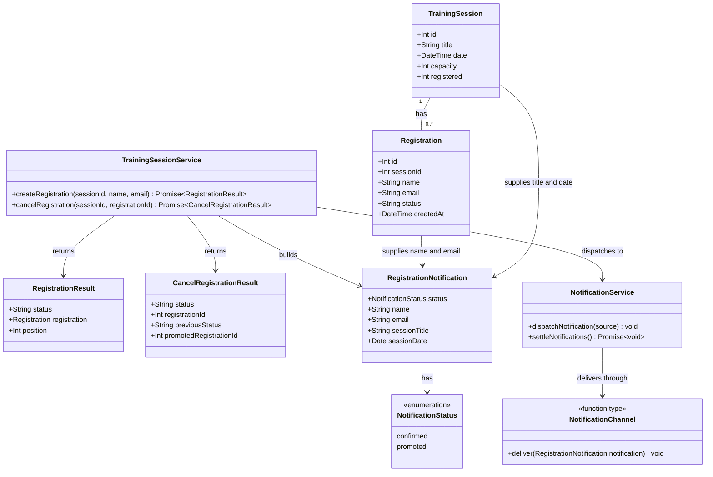

# WH-8: Notify employees after registration or waitlist promotion

## Requirements

- Tell an employee their seat is secured: after a registration is **confirmed**, and after a waitlisted registration is **promoted** (WH-5), produce one server-side notification carrying the employee's name and email, the session's title and date, and the reason (`confirmed` or `promoted`). The baseline delivery is one line on the server console.
- Never let a notification change the outcome: it is dispatched after the business transaction has committed, the request does not wait for it, and a failing channel cannot fail, delay or roll back the registration, the cancellation or the promotion, or alter any API response.
- Give immediate in-app feedback: after the form is submitted the session card shows a success banner with the story's wording, which the employee can dismiss and which disappears by itself after about five seconds.
- Scope: one new notification service, two hooks in the existing training-session service, and the session card's success message area. No API response shape changes, no schema change, no new dependency.
- Out of scope: the Slack channel (AC 10, deferred by the navigator), real email, SMS, notifications for cancellation or for joining the waitlist, notification history, inbox or retry, an in-app banner for the promoted employee, and a frontend test framework.
- **Decisions agreed with the navigator (2026-11-15):**
  1. Slack is deferred. The channel list is the extension point; nothing reads `SLACK_WEBHOOK_URL` in this story.
  2. The waitlist banner keeps the waitlist position.
  3. The five banner criteria (AC 1–5) are verified manually. Backend criteria are covered by automated tests.
  4. Banners are both dismissible and auto-dismissing, at about five seconds.
- **Decisions to review** (made in this canvas; not yet approved):
  1. **Promotion details are read after the commit, not inside the transaction.** The analysis leaned towards capturing them in the transaction. The existing unit tests pin the promotion queries exactly, and the transaction's concurrency handling is delicate, so the promotion step is left untouched and the details are read afterwards inside the fire-and-forget path. A failed read is a silent notification failure.
  2. **The logged field is named `status`**, matching the card's wording, even though `promoted` is a notification reason and not a registration status.
  3. **Joining the waitlist produces a banner but no server notification**, because the backend criteria list only `confirmed` and `promoted`.
  4. **`settleNotifications()` is exported** so tests (and a future graceful shutdown) can wait for in-flight notifications. Production request paths never call it.
  5. **Dismissal applies to every success message on the card**, including the two cancellation messages, because they share one message area. Their wording is unchanged.
  6. **The waitlist banner drops "You are not confirmed yet"** from the WH-3 wording. "You're on the waitlist" plus the existing "Your registration: Waitlisted" label still tell the employee they are not confirmed.

## Entities

- `TrainingSession`, `Registration`, `RegistrationResult` and `CancelRegistrationResult` exist and are **unchanged**. No Prisma schema change.
- `RegistrationNotification`, `NotificationStatus` and `NotificationChannel` are new TypeScript types in the notification service. A notification is built at the moment of the trigger and never stored.
- `promoted` exists only in `NotificationStatus`. `REGISTRATION_STATUS` is not extended.

## Approach

1. Server-side notification as a contained side effect:
   - Add a small notification service next to the training-session service. It owns the notification types, the channel list and all failure containment. It never touches the database.
   - Use a plain dispatcher function, not an event emitter: a listener that throws synchronously would surface in the emitting code path, which is exactly what must not happen.
   - The dispatcher accepts either a ready notification or an async builder that returns one (or `null` for "nothing to send"). The builder form lets the promotion path read the employee's details without the request waiting for that read.
   - Every dispatch is started on a later microtask, is never awaited by the caller, and ends in a catch. An unhandled rejection can terminate the Node process, so no path may leave a promise without one.
   - Each channel is isolated: one channel throwing or rejecting does not stop the others.

2. Trigger points in the service layer:
   - `createRegistration`: after the transaction resolves with a `confirmed` result, dispatch a ready `confirmed` notification built from the committed registration and the session already loaded by the existence pre-check. A `waitlisted` result dispatches nothing.
   - `cancelRegistration`: after the transaction resolves with a non-null `promotedRegistrationId`, dispatch an async builder that reads the promoted registration with its session and returns a `promoted` notification. The transaction body, including `promoteFromWaitlist`, is not modified.
   - Routes are unchanged. They stay thin and never import the notification service or Prisma for this story.

3. Console channel:
   - One `console.log` call per notification, with a single string: the marker `[notification] ` followed by the JSON of `{ status, name, email, sessionTitle, sessionDate }`, where `sessionDate` is an ISO 8601 UTC string.
   - JSON encoding escapes line breaks and quotes, so a crafted name or title cannot forge a second log entry.
   - Failures are reported through `console.error` with the same marker and the error message only. Reporting a failure is itself wrapped so it cannot throw.

4. Testability without awaiting in production:
   - The service tracks in-flight dispatches and exports `settleNotifications()`, which resolves when all of them have finished. Tests call it after the HTTP response and before asserting on console output, which removes the timing race.
   - Tests observe the notification by spying on `console.log`, and force a failure by making that spy throw. No test needs to know how the dispatcher is built.

5. Session card banner:
   - Evolve the existing success message area on the session card; do not add a second surface. Change the two registration messages to the story's wording, add a dismiss control, and add a timed auto-dismiss.
   - The banner is driven only by the API response, so it appears whether or not the server notification worked (AC 5).

6. Delivery:
   - Backend work goes through the project's `/tdd` skill, one Operation slice per run: `test-writer` writes the failing tests from the slice, the navigator confirms RED, `implementer` makes them pass.
   - The frontend Operation is implemented directly and verified manually by the navigator.

## Structure

### Inheritance Relationships

1. No classes or inheritance. The API uses exported functions and plain TypeScript types.
2. `NotificationChannel` is a function type: `(notification: RegistrationNotification) => void | Promise<void>`.
3. `consoleChannel` is the only `NotificationChannel` in this story. A Slack channel would be a second function of the same type added to the channel list.
4. Errors keep the existing convention of thrown `{ status, error }` objects for business failures. The notification service throws nothing to its callers.

### Dependencies

1. `api/src/routes/training-sessions.ts` calls `trainingSessionService` (unchanged).
2. `api/src/services/trainingSessionService.ts` calls `api/src/lib/prisma.ts` and, new, `api/src/services/notificationService.ts`.
3. `api/src/services/notificationService.ts` depends on nothing but the runtime console. It must not import Prisma, Express or `trainingSessionService`.
4. `app/src/components/TrainingSessionCard.tsx` keeps calling the same API endpoints. It gains no new dependency.

### Layered Architecture

1. Route layer (`api/src/routes/`): parameter parsing, HTTP status mapping. No change in this story.
2. Service layer (`api/src/services/trainingSessionService.ts`): business rules, transactions, all database access, and the decision of when a notification is due.
3. Notification layer (`api/src/services/notificationService.ts`): notification types, dispatch, channel isolation, failure containment, settle hook.
4. Data access (`api/src/lib/prisma.ts`): shared Prisma client, used only by the service layer.
5. Error handling: business errors are mapped by each route's existing catch block. Notification failures stop inside the notification layer and are reported to `console.error`.
6. Frontend (`app/src/components/`): the session card owns its own banner state and timer.

## Operations

Operations 1–6 are backend slices. Run each through `/tdd` as its own slice, in this order, passing the Operation's text plus this canvas's Entities, Norms and Safeguards as the navigator packet. Operation 7 is the frontend change. Operation 8 is the final verification.

Shared test conventions for the integration slices (copy the style of `api/tests/integration/wh5-promotes-first-waitlisted.test.ts`):

- Each file has its own `TEST_EMAIL_PREFIX = 'test-wh8-<file-stem>-'`, an `afterEach` that deletes registrations with that prefix and restores any session counters it changed, and an `afterAll` that calls `prisma.$disconnect()`.
- Capture console output per test: `jest.spyOn(console, 'log').mockImplementation(() => undefined)` and the same for `console.error`, restored in `afterEach` with `mockRestore()`.
- After the HTTP call and before asserting on console output, `await settleNotifications()` imported from `../../src/services/notificationService`.
- A local helper `notificationEntries(spy)` returns the parsed payloads of every `console.log` call whose first argument is a string starting with `[notification] `: strip the marker and `JSON.parse` the rest into `unknown`, then narrow with a type guard to `{ status: string; name: string; email: string; sessionTitle: string; sessionDate: string }`. No `any`.
- Assertions about "the entry for this test" filter by an email starting with the file's prefix.

### 1. Slice: a confirmed registration logs one `confirmed` notification (AC 6, 8, 9)

Tests — `api/tests/integration/wh8-confirmed-notification.test.ts`:

- `WH-8 AC 6: a confirmed registration logs one notification`: pick a session with `registered < capacity` from `GET /api/training-sessions`, record its counter, POST a registration with name `Test Confirmed` and email `${PREFIX}confirmed@example.com`, expect 201, settle, then expect exactly one notification entry for that email.
- `WH-8 AC 8: the notification carries the employee and session details`: same setup; expect the entry to equal `{ status: 'confirmed', name: 'Test Confirmed', email: <the email>, sessionTitle: <session.title from the GET>, sessionDate: <session.date from the GET> }`. The GET returns the date as an ISO string, which is what the entry must contain.
- `WH-8 AC 9: the notification is a single console line with the marker`: expect the matching `console.log` call to have exactly one argument, a string that starts with `[notification] ` and contains no line break.

Implementation — create `api/src/services/notificationService.ts`:

1. Types:
   - `export type NotificationStatus = 'confirmed' | 'promoted'`
   - `export type RegistrationNotification = { status: NotificationStatus; name: string; email: string; sessionTitle: string; sessionDate: Date }`
   - `export type NotificationChannel = (notification: RegistrationNotification) => void | Promise<void>`
   - `export type NotificationSource = RegistrationNotification | (() => Promise<RegistrationNotification | null>)`
2. Constants: `const LOG_MARKER = '[notification]'`.
3. `const consoleChannel: NotificationChannel`:
   - `console.log(`${LOG_MARKER} ${JSON.stringify({ status, name, email, sessionTitle, sessionDate: notification.sessionDate.toISOString() })}`)` with the keys in that order.
4. `const channels: NotificationChannel[] = [consoleChannel]`.
5. `function reportFailure(error: unknown): void`:
   - Inside a `try`, call `console.error(`${LOG_MARKER} delivery failed:`, error instanceof Error ? error.message : 'unknown error')`. The `catch` is empty with the comment `// Reporting must never throw.`
6. `async function deliver(notification: RegistrationNotification): Promise<void>`:
   - `await Promise.all(channels.map((channel) => Promise.resolve().then(() => channel(notification)).catch(reportFailure)))`. Wrapping in `Promise.resolve().then` turns a synchronous throw into a rejection, so each channel is isolated.
7. `const pending = new Set<Promise<void>>()`.
8. `export function dispatchNotification(source: NotificationSource): void`:
   - `const work: Promise<void> = Promise.resolve().then(() => (typeof source === 'function' ? source() : source)).then((notification) => (notification ? deliver(notification) : undefined)).catch(reportFailure)`
   - `pending.add(work)`, then `void work.then(() => pending.delete(work))`.
   - The function returns immediately and never throws. Comment above it: `// Fire-and-forget: callers must not await this, and a failure here never reaches them.`
9. `export async function settleNotifications(): Promise<void>`:
   - `while (pending.size > 0) await Promise.all([...pending])`. Comment: `// For tests and shutdown: resolves once every in-flight notification has finished.`

Implementation — update `api/src/services/trainingSessionService.ts`:

1. Import `dispatchNotification` from `./notificationService`.
2. In `createRegistration`, assign the transaction's result instead of returning it directly: `const result = await prisma.$transaction(...)` with the callback body unchanged.
3. After it: `if (result.status === 'confirmed') { dispatchNotification({ status: 'confirmed', name: result.registration.name, email: result.registration.email, sessionTitle: session.title, sessionDate: session.date }) }`, with the comment `// After the commit, so a rolled-back registration is never announced.`
4. `return result`.

### 2. Slice: joining the waitlist logs no notification

Tests — `api/tests/integration/wh8-waitlisted-no-notification.test.ts`:

- `WH-8: a waitlisted registration logs no notification`: pick a session with `registered < capacity`, record its counter, set `registered = capacity` with `prisma.trainingSession.update`, POST a registration, expect 202, settle, then expect zero notification entries for the file's email prefix.

Implementation: none expected. Operation 1's `confirmed` guard already covers it, so this test may pass as soon as it is written. If it does, report that to the navigator at the RED checkpoint instead of forcing a failure; the test stays as a regression guard.

### 3. Slice: a failing notification does not fail the registration (AC 11, AC 5 server side)

Tests — `api/tests/integration/wh8-registration-survives-notification-failure.test.ts`:

- `WH-8 AC 11: registration succeeds when the notification channel throws`: make the `console.log` spy throw `new Error('console unavailable')`, POST a registration to a session with space, expect 201 and a body with `id` a number, `status: 'confirmed'` and the submitted name and email, then settle.
- `WH-8 AC 11: the registration is persisted when the notification fails`: same setup; read the row back with `prisma.registration.findUnique` and expect `status: 'confirmed'`; expect the session's `registered` (via GET) to be one higher than before.
- `WH-8 AC 11: a notification failure is reported, not thrown`: same setup; after settling, expect `console.error` to have been called with a first argument starting with `[notification] delivery failed`.

Implementation: none expected beyond Operation 1 if it was built as specified. If the first two tests pass at RED, report that; the third pins the failure report.

### 4. Slice: a waitlist promotion logs one `promoted` notification (AC 7, 8)

Tests — `api/tests/integration/wh8-promoted-notification.test.ts`, with a `setUpFullSession()` helper like WH-5's (fill a session to `capacity - 1`, POST one confirmed and two waitlisted registrations named `Test Confirmed`, `Test First Waitlisted`, `Test Second Waitlisted`):

- `WH-8 AC 7: cancelling a confirmed registration logs a promoted notification for the promoted employee`: set up, settle, reset the `console.log` spy's calls with `mockClear()`, DELETE the confirmed registration, expect 200, settle, then expect exactly one notification entry for the file's prefix, equal to `{ status: 'promoted', name: 'Test First Waitlisted', email: <first waitlisted email>, sessionTitle: <session.title>, sessionDate: <session.date> }`.
- `WH-8: the cancelling employee gets no notification`: same flow; expect no entry whose email is the cancelled registration's.
- `WH-8: the cancellation response is unchanged`: expect the DELETE body to equal `{ status: 'cancelled', promotedRegistrationId: <first waitlisted id> }` exactly.

Implementation — update `api/src/services/trainingSessionService.ts`:

1. Import the type `RegistrationNotification` from `./notificationService`.
2. Add, above `cancelRegistration`:
   - `async function buildPromotionNotification(registrationId: number): Promise<RegistrationNotification | null>`
   - Logic: `const promoted = await prisma.registration.findUnique({ where: { id: registrationId }, select: { name: true, email: true, session: { select: { title: true, date: true } } } })`. If `!promoted`, return `null`. Otherwise return `{ status: 'promoted', name: promoted.name, email: promoted.email, sessionTitle: promoted.session.title, sessionDate: promoted.session.date }`.
   - Comment: `// Read after the commit and outside the transaction: a failure here is a lost notification, never a failed cancellation.`
3. In `cancelRegistration`, assign the transaction's result: `const result = await prisma.$transaction(...)` with the callback body unchanged, including `promoteFromWaitlist`.
4. After it: `const promotedId = result.promotedRegistrationId`, then `if (promotedId !== null) { dispatchNotification(() => buildPromotionNotification(promotedId)) }`.
5. `return result`.

### 5. Slice: cancellations without a promotion log no notification

Tests — `api/tests/integration/wh8-no-promotion-no-notification.test.ts`:

- `WH-8: cancelling with an empty waitlist logs no notification`: POST one confirmed registration to a session with space and `waitlisted === 0`, settle, clear the spy, DELETE it, expect 200 with `promotedRegistrationId: null`, settle, expect zero notification entries for the prefix.
- `WH-8: cancelling a waitlisted registration logs no notification`: full-session setup, settle, clear the spy, DELETE the first waitlisted registration, expect 200 with `promotedRegistrationId: null`, settle, expect zero entries for the prefix.

Implementation: none expected. Operation 4's null guard covers it; if the tests pass at RED, report that and keep them as regression guards.

### 6. Slice: a failing notification does not fail the promotion, plus unit coverage (AC 11)

Tests — `api/tests/integration/wh8-promotion-survives-notification-failure.test.ts`:

- `WH-8 AC 11: cancellation and promotion succeed when the notification channel throws`: full-session setup, settle, make the `console.log` spy throw, DELETE the confirmed registration, expect 200 and `promotedRegistrationId` equal to the first waitlisted id, settle, then read both rows with prisma and expect the cancelled one to be `cancelled` and the promoted one `confirmed`.

Tests — create `api/tests/unit/notificationService.test.ts` (no Prisma mock needed; spy on `console.log` and `console.error`):

- `dispatchNotification returns before the notification is delivered`: call it with a ready notification and expect `console.log` not yet called on the same tick; after `await settleNotifications()`, expect it called once.
- `logs the notification as one marked JSON line with an ISO date`: expect the single argument to equal `[notification] ` plus the JSON of the five fields with `sessionDate` as `toISOString()`.
- `a name containing a line break cannot forge a second entry`: dispatch with `name: 'Eve\n[notification] {"status":"confirmed"}'`; expect one `console.log` call whose string has no raw line break and whose parsed `name` equals the original.
- `accepts an async builder`: dispatch `async () => notification`; after settling, expect one entry.
- `sends nothing when the builder returns null`: expect `console.log` and `console.error` not called.
- `contains a builder that rejects`: dispatch `async () => { throw new Error('lookup failed') }`; expect `settleNotifications()` to resolve, `console.log` not called, and `console.error` called with `[notification] delivery failed:` and `'lookup failed'`.
- `contains a channel that throws`: make `console.log` throw; expect `dispatchNotification` not to throw, `settleNotifications()` to resolve, and `console.error` called.
- `contains a failure in failure reporting`: make both `console.log` and `console.error` throw; expect `settleNotifications()` to resolve.
- `settleNotifications resolves immediately when nothing is pending`.

Tests — edit `api/tests/unit/trainingSessionService.test.ts` (add; do not change existing expectations):

- Add `jest.mock('../../src/services/notificationService', () => ({ __esModule: true, dispatchNotification: jest.fn(), settleNotifications: jest.fn() }))`, import `dispatchNotification`, and add `findUnique: jest.fn()` to the mocked `registration` object.
- `createRegistration dispatches a confirmed notification after a confirmed registration`: expect `dispatchNotification` called once with `{ status: 'confirmed', name: 'Test Attendee', email: 'test@example.com', sessionTitle: mockSession.title, sessionDate: mockSession.date }`.
- `createRegistration dispatches nothing for a waitlisted registration`.
- `createRegistration dispatches nothing when the transaction rejects`.
- `cancelRegistration dispatches a promotion builder when someone was promoted`: expect `dispatchNotification` called once with a function; mock `prisma.registration.findUnique` to return a name, email and nested session; call the captured function and expect it to resolve to the `promoted` notification; expect `findUnique` called with `where: { id: <promoted id> }`.
- `the promotion builder resolves to null when the registration is gone`.
- `cancelRegistration dispatches nothing when nobody was promoted` and `... when a waitlisted registration is cancelled`.

Implementation: none expected in `trainingSessionService.ts`. Fix whatever these tests expose in `notificationService.ts`, most likely the reporting guard in `reportFailure`.

### 7. Session card banner: `app/src/components/TrainingSessionCard.tsx` and `.css` (AC 1–5, manual)

Implemented directly, not through `/tdd`.

1. Add `const SUCCESS_BANNER_MS = 5000` beneath `API_BASE`.
2. In `handleSubmit`:
   - Confirmed (201): `setSuccessMessage(`You're registered! ${session.title} on ${formatDate(session.date)}`)`.
   - Waitlisted (202): `setSuccessMessage(`You're on the waitlist for ${session.title} (position ${body.position}). We'll let you know if a spot opens up.`)`.
   - Nothing else in `handleSubmit` changes: the saved registration, the form reset and `onRegistered()` stay as they are.
3. Add an effect for auto-dismiss, after the existing refresh effect:
   - `useEffect(() => { if (successMessage === null) return; const timer = window.setTimeout(() => setSuccessMessage(null), SUCCESS_BANNER_MS); return () => window.clearTimeout(timer) }, [successMessage])`
   - The cleanup clears the timer when the message changes or the card unmounts, so a timer never acts on a card that is gone and a new message restarts the countdown.
4. Replace the success paragraph with a banner that keeps `role="status"`:
   - A `div` with class `session-card__success session-card__banner` and `role="status"`, containing a `span` with the message and a `button` with `type="button"`, class `session-card__banner-dismiss`, `aria-label="Dismiss"`, text `×`, and `onClick={() => setSuccessMessage(null)}`.
5. `TrainingSessionCard.css`: add `.session-card__banner` (flex row, space between, aligned centre, small gap) and `.session-card__banner-dismiss` (no background or border, inherits colour, pointer cursor, visible focus outline). Reuse the existing success colours; do not restyle `.session-card__success`.
6. The cancellation messages (`Your registration has been cancelled`, `This registration was already cancelled`) keep their wording and gain the same dismissal because they use the same area.
7. No change to `app/src/types/index.ts` or `app/src/lib/myRegistrations.ts`.

### 8. Verify

1. `make test`, `make lint`, `make typecheck` and `make format-check` all pass. The WH-2 to WH-5 suites pass without any of their assertions being edited, apart from the additions to the unit test file in Operation 6.
2. Manual checks by the navigator with `make dev`:
   - Register for a session with space: the banner reads `You're registered! <title> on <date>` without a page reload, and the server console shows one `[notification]` line with `"status":"confirmed"`.
   - Register for a full session: the banner reads `You're on the waitlist for <title> (position N). We'll let you know if a spot opens up.` and the server console shows no `[notification]` line.
   - The banner disappears after about five seconds, and the `×` button removes it sooner.
   - Cancel a confirmed registration on a session with a waitlist: the server console shows one `[notification]` line with `"status":"promoted"` for the first waitlisted employee.
3. Story file `stories/wh-8-notify-registration-promotion.md`: tick AC 1–9 and 11 as they are verified. Leave AC 10 unticked with the note `Deferred: Slack channel not implemented in WH-8`.

## Norms

1. TypeScript: no `any` and no `as any`. Parsed JSON is `unknown` and narrowed with a type guard. Use explicit return types on exported functions.
2. Layering: route handlers never import or call Prisma or the notification service. All database access lives in `trainingSessionService.ts`. `notificationService.ts` has no database access.
3. Error handling:
   - Business errors keep the existing thrown `{ status, error }` shape and the routes' existing mapping.
   - The notification service never throws to its caller and never leaves a promise without a catch.
   - A notification failure is reported once through `console.error` with the `[notification]` marker and the error message only.
4. Logging: a notification is exactly one `console.log` call with one string argument, `[notification] ` followed by JSON. Do not add other log lines on the success path.
5. Naming and style: match the surrounding code: `camelCase` functions, `UPPER_SNAKE` module constants, single quotes, no semicolons, Prettier formatting per `.prettierrc`. Comments are short and explain why, at the density of the existing service file.
6. Tests: integration tests use Supertest against the exported `app`, emails starting with `test-`, cleanup in `afterEach`, `prisma.$disconnect()` in `afterAll`. Unit tests mock `../../src/lib/prisma` as the existing unit test does. Every console spy is restored in `afterEach`. Each `it` name starts with `WH-8` in integration tests.
7. Process: backend slices go through `/tdd`, one slice per run. Tests are never weakened, skipped or deleted to get green.
8. Frontend: function components and hooks only, state local to the card, every timer cleared in an effect cleanup, interactive elements are real `button`s with an accessible name.

## Safeguards

1. Functional constraints:
   - Exactly one notification per confirmed registration and one per promotion. None for a waitlisted registration, a cancellation without a promotion, a rejected request or a rolled-back transaction.
   - The `promoted` notification names the registration that was actually promoted (the id in `promotedRegistrationId`), never the cancelling employee.
   - No notification is stored, retried or queued. A notification in flight when the server stops is lost; this is an accepted limitation.
2. Non-interference constraints:
   - No API response body, status code or header changes. `POST /registrations` still returns 201 with the registration or 202 with `{ status, position, id }`; `DELETE` still returns `{ status: 'cancelled', promotedRegistrationId }`.
   - The bodies of both existing transactions, including `promoteFromWaitlist` and its retry loop, are not modified.
   - `dispatchNotification` is called only after the transaction promise has resolved, and its result is never awaited on a request path.
   - `settleNotifications` is never called from `api/src/routes/` or from the request path of a service function.
3. Reliability constraints:
   - A channel that throws synchronously, rejects, or a builder that rejects must not produce an unhandled rejection or an uncaught exception.
   - One channel failing must not prevent the other channels from running.
   - Failure reporting must not throw even if `console.error` does.
4. Security and privacy constraints:
   - The console entry is JSON-encoded so user-supplied text cannot inject line breaks or forge entries.
   - The entry contains only the five fields in the story. No registration ids, tokens, request data or stack traces.
   - Name and email on the server console are accepted by the story; do not send them anywhere else in this story.
   - Do not read `SLACK_WEBHOOK_URL` or make any outbound network call. Do not add a runtime dependency.
5. Scope constraints (do-nots):
   - No Slack channel, email, SMS, notification table, outbox, queue or event emitter.
   - No notification for cancellation or for joining the waitlist.
   - No change to the Prisma schema, the seed, the routes, `app.ts`, `server.ts`, Jest, ESLint, Prettier or TypeScript config.
   - No frontend test framework and no new frontend component file.
   - No changes to cancellation wording, the status label, the localStorage format or the status refresh on the session card.
6. Test constraints:
   - Existing assertions in the WH-2 to WH-5 integration tests and the existing unit tests are not edited. The unit test file may only gain the notification mock, the `findUnique` mock and new tests.
   - Tests never assert on console output without first awaiting `settleNotifications()`.
   - Console spies are scoped to a test and restored afterwards so suites do not affect each other.
7. Frontend constraints:
   - The banner text matches the story's wording exactly, with the waitlist position added in parentheses after the session title.
   - The banner appears without a page reload and depends only on the API response.
   - Auto-dismiss is 5000 ms; the dismiss control is keyboard reachable and has an accessible name; the message area keeps `role="status"`.
8. Quality gates: `make test`, `make lint`, `make typecheck` and `make format-check` pass before a PR is opened. No lint rule is disabled and no hook is bypassed.
