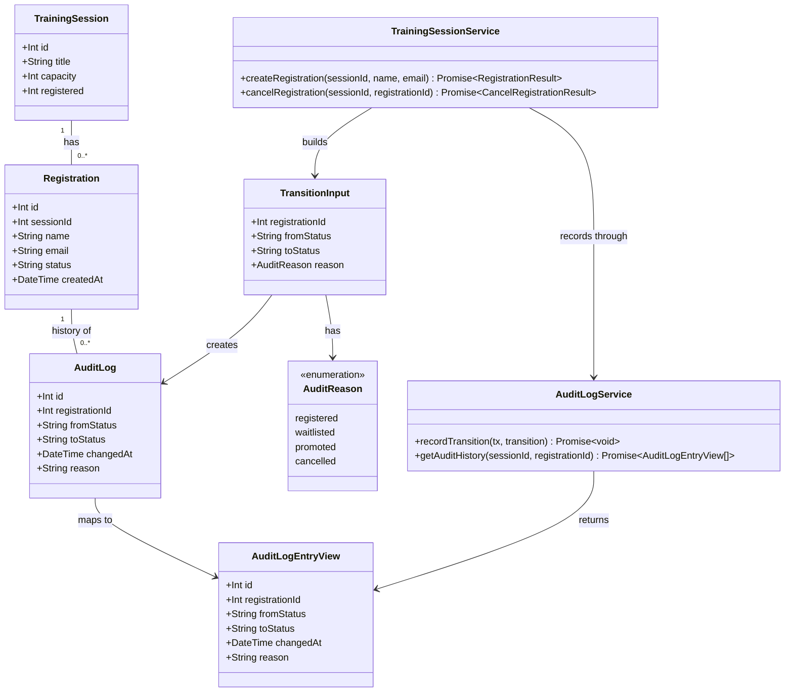

# WH-9: Audit log for registration state changes

## Requirements

- Give a training organiser the full history of one registration: every time a registration changes state, record one permanent audit entry saying which registration moved from which status to which status, when, and why, so the history can be read back for reporting or dispute resolution.
- Make the record trustworthy: the entry is written in the same database transaction as the state change it describes. Either both happen or neither does. A rejected or rolled-back request leaves no entry.
- Cover every state change the system can make: initial registration (nothing → confirmed, nothing → waitlisted), cancellation (confirmed → cancelled, waitlisted → cancelled) and waitlist promotion (waitlisted → confirmed).
- Expose the history read-only at `GET /api/training-sessions/:id/registrations/:registrationId/audit`, oldest entry first, answering 404 when the registration does not exist under that session. The API offers no way to change or remove an entry.
- Scope: one new table, one new small audit service, three recording calls in the existing training-session service, one new GET route. API only. No response shape, status code or notification behaviour of an existing endpoint changes.
- Out of scope: the organiser's registrations page (WH-6), any frontend change, recording who made the change, authentication or roles, a reason supplied by the caller, backfilling history for registrations that already exist, seed changes, auditing anything other than registrations, and the missing `promoted` notification in `cancelRegistration` (observed during analysis, belongs to WH-8).
- **Decisions to review** (the analysis and this canvas were produced unattended; none of these was confirmed by a navigator):
  1. **The acceptance criteria are taken as the full scope.** The card's text is cut off after them, so any exclusions, suggested tests or hints it carried are unknown.
  2. **API only.** The first criterion (finding the registration ID on the WH-6 page) is treated as context. The ID comes from the registration response.
  3. **No actor is recorded.** The card's context says "who did what", but the required fields have no actor and the system has no sign-in.
  4. **`reason` is a fixed label set by the system**: `registered`, `waitlisted`, `promoted` or `cancelled`. Callers cannot supply one.
  5. **`null → waitlisted` is labelled `waitlisted`** and `null → confirmed` is labelled `registered`. Both cancellations are labelled `cancelled`.
  6. **Entries are deleted with their registration** (cascade). The API never deletes a registration, so immutability "via the API" holds, but the seed, `make reset-db`, session deletion and test cleanup remove registrations directly and take the history with them. This is the compliance-relevant choice.
  7. **No backfill.** A registration that pre-dates the log returns `200` with an empty list, not `404`.
  8. **The seed is unchanged.** Its two fixture registrations have no history.
  9. **The response is a bare JSON array** of `{ id, registrationId, fromStatus, toStatus, changedAt, reason }`. The first entry's `fromStatus` is an explicit `null`.
  10. **Entries with the same timestamp are ordered by `id`** (creation order).
  11. **Immutability is met by offering no modifying route.** `POST`, `PUT`, `PATCH` and `DELETE` on the audit address get the API's ordinary `404`, not an explicit `405`.
  12. **`404` also covers** an unknown session, a registration requested under a different session, and malformed identifiers, matching the neighbouring registration lookup.
  13. **The endpoint is open**, like the rest of the API. Entries carry no name or email.
  14. **A failed audit write aborts the registration, cancellation or promotion.** That is what "atomically" asks for; it means an audit fault stops employees registering or cancelling.
  15. **Criterion 4 ("a complete picture") has no deliverable of its own.** It is met by the others together.
  16. **The table is `audit_logs`** (Prisma model `AuditLog`), following the existing lower-case plural naming, and `changedAt` is set by the system at insert.
  17. **The audit service lives in its own file** and is called explicitly at the three state-change points; no Prisma extension and no database trigger.

## Entities



- `TrainingSession` is unchanged. `Registration` gains only the back-relation field `auditLogs`; no column is added to `registrations` and the `Registration` TypeScript type is unchanged.
- `AuditLog` is the only new stored entity. `fromStatus` and `reason` are nullable; `fromStatus` is `null` only for the first entry of a registration.
- `fromStatus` and `toStatus` use the existing vocabulary in `REGISTRATION_STATUS` (`confirmed`, `waitlisted`, `cancelled`) and are stored as plain text, as `Registration.status` is.
- `AuditReason`, `TransitionInput` and `AuditLogEntryView` are TypeScript types in the audit service. `promoted` and `registered` are reasons, not registration statuses; `REGISTRATION_STATUS` is not extended.
- `getAuditHistory` returns `null` (not an empty list) when the registration does not exist under the session.

## Approach

1. Data model:
   - Add an `AuditLog` model to `api/prisma/schema.prisma`, mapped to `audit_logs`, owned by `Registration` with `onDelete: Cascade`, the same ownership rule `Registration` already has towards `TrainingSession`.
   - Cascade is required, not just preferred: about twenty integration suites and the seed bulk-delete registrations. A restricting relation would break all of them.
   - There are no migration files. The table arrives by `prisma db push`, locally, in CI and at container start.

2. Write side, explicit recording inside the existing transactions:
   - A new `auditLogService.ts` owns how an entry is written and read. Its `recordTransition` takes the caller's `Prisma.TransactionClient`, so the entry is part of the caller's transaction and cannot be written outside one.
   - `trainingSessionService.ts` calls it at the three points where a state change is known to have taken effect: after `registration.create` (both branches), after the cancelling `updateMany` matched a row, and after the promoting `updateMany` matched a row.
   - The guarded updates return only a count, so the entry is built from what the operation already holds: the status it matched on and the id it targeted. It is written only when the count is greater than zero.
   - An error from `recordTransition` is not caught. It leaves the transaction callback, Prisma rolls the transaction back, and the route's existing handler answers `500`.
   - The post-commit notification (WH-8) stays where it is. The audit entry is its deliberate opposite: inside the transaction and able to fail the request.

3. Read side:
   - `getAuditHistory` first confirms the registration exists under the session (same `findFirst` scoping as `getRegistrationStatus`), then returns its entries ordered by `changedAt` ascending with `id` as the tie-break.
   - A new GET route beneath the existing registration lookup validates both identifiers with the existing `parsePositiveInt` and maps `null` to `404`. The route calls the service only; it does not touch Prisma.

4. Immutability:
   - Only the GET route is added. No service function updates or deletes an entry. Requests with a modifying method on the audit address fall through to Express's default `404`; tests pin that and that the history is unchanged afterwards.

5. Risks carried from the analysis and how they are handled:
   - Hand-built transaction mocks in `api/tests/unit/trainingSessionService.test.ts` do not have `auditLog`. The unit test file mocks `recordTransition` at the module boundary (as it does for the notification service), so no existing transaction mock has to change.
   - `make test` does not push the schema. Operation 1 pushes it to the local development database once; CI and the container already do.
   - SQLite allows one writer at a time and each state change gains one insert. Watch the existing concurrency tests for lock timeouts; do not raise timeouts or retries to hide one.

6. Delivery:
   - Operation 1 (schema) is applied directly. Operations 2 to 7 each go through the project's `/tdd` skill, one Operation per run: `test-writer` writes the failing tests, `implementer` makes them pass.

## Structure

### Inheritance Relationships

1. No classes or inheritance. The API uses exported functions and plain TypeScript types.
2. `AuditReason` is the union of the values of the `AUDIT_REASON` constant object, declared the same way as `REGISTRATION_STATUS`.

### Dependencies

1. `api/src/routes/training-sessions.ts` imports `getAuditHistory` from `api/src/services/auditLogService.ts`.
2. `api/src/services/trainingSessionService.ts` imports `recordTransition` and `AUDIT_REASON` from `./auditLogService`.
3. `api/src/services/auditLogService.ts` imports `prisma` from `../lib/prisma` and the `Prisma` type from `@prisma/client`. It imports nothing from `trainingSessionService.ts` or `notificationService.ts` (no import cycle).
4. `notificationService.ts`, `app.ts`, `server.ts` and `api/prisma/seed.ts` are unchanged.

### Layered Architecture

1. Route layer (`api/src/routes/training-sessions.ts`): identifier validation and HTTP mapping for the new GET route. No Prisma for this story.
2. Service layer:
   - `trainingSessionService.ts`: owns the three state changes and decides when a transition happened.
   - `auditLogService.ts`: owns how an entry is written (`recordTransition`) and read (`getAuditHistory`).
3. Data layer (`api/prisma/schema.prisma`): the `AuditLog` model and its cascade relation.
4. Error handling: no global handler exists. The service signals "not found" by returning `null`; the route maps it to `404` and unexpected errors to `500`, as the neighbouring routes do.

### Files

| File                                                   | Change                                                          |
| ------------------------------------------------------ | --------------------------------------------------------------- |
| `api/prisma/schema.prisma`                             | Add `AuditLog`; add `auditLogs` back-relation on `Registration` |
| `api/src/services/auditLogService.ts`                  | New                                                             |
| `api/src/services/trainingSessionService.ts`           | Three `recordTransition` calls                                  |
| `api/src/routes/training-sessions.ts`                  | One GET route                                                   |
| `api/tests/unit/auditLogService.test.ts`               | New                                                             |
| `api/tests/unit/trainingSessionService.test.ts`        | Add audit-service mock and new tests                            |
| `api/tests/integration/wh9-*.test.ts`                  | New, one file per Operation 2 to 7                              |
| `stories/wh-9-audit-log-registration-state-changes.md` | Tick criteria in Operation 8                                    |

## Operations

### 1. Schema: `AuditLog` model (AC 5)

Applied directly, not through `/tdd`.

1. In `api/prisma/schema.prisma`, add to `Registration`, after the `session` relation line: `auditLogs AuditLog[]`.
2. Add after the `Registration` model:

   ```prisma
   model AuditLog {
     id             Int          @id @default(autoincrement())
     registrationId Int
     // null for the first entry: the registration did not exist before.
     fromStatus     String?
     toStatus       String
     changedAt      DateTime     @default(now())
     // registered | waitlisted | promoted | cancelled, set by the system.
     reason         String?
     registration   Registration @relation(fields: [registrationId], references: [id], onDelete: Cascade)

     @@index([registrationId])
     @@map("audit_logs")
   }
   ```

3. Apply it to the local development database and regenerate the client: `cd api && pnpm exec prisma db push`. This is additive (one new table); existing rows are kept. Do not use `--force-reset`, `make reset-db` or `make setup` for this.
4. Completion check: `make typecheck` passes and `make test` is still green with no test changed.

### 2. Slice: read endpoint, not-found handling and empty history (AC 2, 9)

Tests — `api/tests/integration/wh9-audit-history-lookup.test.ts`. Fixture: pick an existing session from `GET /api/training-sessions`, and create a registration directly with `prisma.registration.create` (status `confirmed`, email with the file's `test-wh9-audit-history-lookup-` prefix) so it has no history.

- `WH-9: a registration with no audit entries returns 200 and an empty list`: GET the audit address; expect `200` and body `[]`.
- `WH-9 AC 9: an unknown registration returns 404`: use an id far above any real one; expect `404` and `{ error: 'Registration not found' }`.
- `WH-9: an unknown session returns 404`: real registration id under a session id that does not exist.
- `WH-9: a registration requested under a different session returns 404`: real registration id under another existing session's id.
- `WH-9: malformed identifiers return 404`: for each of `abc`, `0`, `-1`, `1.5` and `99999999999999999999` as the registration id, and `abc` as the session id, expect `404`.

Tests — `api/tests/unit/auditLogService.test.ts`, mocking `../../src/lib/prisma` with `registration.findFirst` and `auditLog.findMany`:

- `getAuditHistory returns null without reading entries when the registration is not found`: `findFirst` resolves `null`; expect `null` and `auditLog.findMany` not called.
- `getAuditHistory scopes the registration by session`: expect `findFirst` called with `where: { id: 5, sessionId: 1 }`.
- `getAuditHistory reads entries oldest first with id as tie-break`: expect `findMany` called with `where: { registrationId: 5 }` and `orderBy: [{ changedAt: 'asc' }, { id: 'asc' }]`, and the resolved rows returned unchanged.

Implementation — create `api/src/services/auditLogService.ts`:

1. `export type AuditLogEntryView = { id: number; registrationId: number; fromStatus: string | null; toStatus: string; changedAt: Date; reason: string | null }`
2. `const HISTORY_ORDER = [{ changedAt: 'asc' }, { id: 'asc' }] as const satisfies Prisma.AuditLogOrderByWithRelationInput[]` with the comment `// Oldest first; id breaks ties between entries written in the same millisecond.`
3. `export async function getAuditHistory(sessionId: number, registrationId: number): Promise<AuditLogEntryView[] | null>`
   - `const registration = await prisma.registration.findFirst({ where: { id: registrationId, sessionId }, select: { id: true } })`
   - If `!registration`, return `null`.
   - Return `prisma.auditLog.findMany({ where: { registrationId }, orderBy: HISTORY_ORDER, select: { id: true, registrationId: true, fromStatus: true, toStatus: true, changedAt: true, reason: true } })`.

Implementation — `api/src/routes/training-sessions.ts`: add, directly after the existing `GET /:id/registrations/:registrationId` handler:

1. `router.get('/:id/registrations/:registrationId/audit', ...)`.
2. Parse both params with `parsePositiveInt`; if either is `null`, respond `404` with `{ error: 'Registration not found' }`.
3. `const history = await getAuditHistory(sessionId, registrationId)`; if `null`, respond `404` with `{ error: 'Registration not found' }`; otherwise `res.status(200).json(history)`.
4. On an unexpected error: `console.error('Error fetching audit history:', error)` and `500` with `{ error: 'Failed to fetch audit history' }`.

### 3. Slice: initial registration is recorded (AC 3, 6, 10)

Tests — `api/tests/integration/wh9-initial-registration-audit.test.ts`. Counter handling and full-session setup follow `wh5-promotes-first-waitlisted.test.ts` (remember each touched session's `registered`, restore it in `afterEach`).

- `WH-9 AC 10: a confirmed registration has one entry from null to confirmed`: POST to a session with space, expect `201`, GET the audit address, expect `200` and exactly one entry with `fromStatus: null`, `toStatus: 'confirmed'`, `reason: 'registered'`, `registrationId` equal to the new id, a numeric `id`, and `changedAt` a valid ISO date string.
- `WH-9 AC 10: a waitlisted registration has one entry from null to waitlisted`: fill a session, POST, expect `202`, GET the audit address with the returned `id`, expect exactly one entry with `fromStatus: null`, `toStatus: 'waitlisted'`, `reason: 'waitlisted'`.
- `WH-9: a rejected registration writes no entry`: count `prisma.auditLog` rows, POST with an invalid email (expect `400`) and POST to an unknown session (expect `404`), expect the count unchanged.
- `WH-9: the registration responses are unchanged`: the `201` body still equals the registration row (`id`, `sessionId`, `name`, `email`, `status`, `createdAt`, no audit fields) and the `202` body still equals `{ status: 'waitlisted', position, id }`.

Tests — `api/tests/unit/auditLogService.test.ts` (add):

- `recordTransition creates one entry through the given transaction client`: call with a hand-built `tx` whose `auditLog.create` is a `jest.fn()`; expect it called once with exactly `{ data: { registrationId: 7, fromStatus: null, toStatus: 'confirmed', reason: 'registered' } }` (no `changedAt`), and the default `prisma` client's `auditLog` not used.
- `recordTransition lets a write failure propagate`: `create` rejects; expect the call to reject with the same error.

Tests — edit `api/tests/unit/trainingSessionService.test.ts` (add; do not change existing expectations):

- Add `jest.mock('../../src/services/auditLogService', () => ({ __esModule: true, ...jest.requireActual('../../src/services/auditLogService'), recordTransition: jest.fn() }))` and import `recordTransition` as a mock. With this in place the existing hand-built transaction objects need no `auditLog` member.
- `createRegistration records null to confirmed inside the transaction`: expect `recordTransition` called once with the transaction object passed to the callback and `{ registrationId: mockRegistration.id, fromStatus: null, toStatus: 'confirmed', reason: 'registered' }`.
- `createRegistration records null to waitlisted inside the transaction`: full-session mocks; expect one call with `toStatus: 'waitlisted'`, `reason: 'waitlisted'`.
- `createRegistration records nothing when validation fails or the session is unknown`.

Implementation — `api/src/services/auditLogService.ts` (add):

1. `export const AUDIT_REASON = { registered: 'registered', waitlisted: 'waitlisted', promoted: 'promoted', cancelled: 'cancelled' } as const`
2. `export type AuditReason = (typeof AUDIT_REASON)[keyof typeof AUDIT_REASON]`
3. `export type TransitionInput = { registrationId: number; fromStatus: string | null; toStatus: string; reason: AuditReason }`
4. `export async function recordTransition(tx: Prisma.TransactionClient, transition: TransitionInput): Promise<void>`
   - `await tx.auditLog.create({ data: { registrationId: transition.registrationId, fromStatus: transition.fromStatus, toStatus: transition.toStatus, reason: transition.reason } })`
   - No try/catch. Comment: `// Takes the caller's transaction: the entry commits or rolls back with the state change it describes.`

Implementation — `api/src/services/trainingSessionService.ts`, in `createRegistration`'s transaction callback:

1. Confirmed branch: after `tx.registration.create`, before `return`: `await recordTransition(tx, { registrationId: registration.id, fromStatus: null, toStatus: REGISTRATION_STATUS.confirmed, reason: AUDIT_REASON.registered })`.
2. Waitlisted branch: after `tx.registration.create`, before the position count: the same call with `toStatus: REGISTRATION_STATUS.waitlisted` and `reason: AUDIT_REASON.waitlisted`.
3. Nothing else in the function changes, including the post-commit `dispatchNotification`.

### 4. Slice: cancellation is recorded (AC 3, 6, 10)

Tests — `api/tests/integration/wh9-cancellation-audit.test.ts`:

- `WH-9 AC 3: cancelling a confirmed registration appends confirmed to cancelled`: POST (`201`), DELETE (`200`), GET audit; expect exactly two entries in order: `null → confirmed` (`registered`), then `confirmed → cancelled` (`cancelled`).
- `WH-9: cancelling a waitlisted registration appends waitlisted to cancelled`: full session, POST (`202`), DELETE, GET audit; expect `null → waitlisted` (`waitlisted`), then `waitlisted → cancelled` (`cancelled`).
- `WH-9: a repeated cancel is rejected and writes no entry`: cancel twice; second is `409`; history still has two entries.
- `WH-9: the cancellation response is unchanged`: DELETE body equals `{ status: 'cancelled', promotedRegistrationId: null }` exactly.

Tests — edit `api/tests/unit/trainingSessionService.test.ts` (add):

- `cancelRegistration records the status it matched on to cancelled`: for `confirmed` and for `waitlisted`; expect `recordTransition` called with `{ registrationId, fromStatus: <previous>, toStatus: 'cancelled', reason: 'cancelled' }`.
- `cancelRegistration records nothing when the registration is missing, already cancelled, or the guarded update matched no row`.

Implementation — `api/src/services/trainingSessionService.ts`, in `cancelRegistration`: directly after the `if (flipped.count === 0)` guard and before the promotion block, add `await recordTransition(tx, { registrationId, fromStatus: previousStatus, toStatus: REGISTRATION_STATUS.cancelled, reason: AUDIT_REASON.cancelled })`.

### 5. Slice: promotion is recorded on the promoted registration (AC 3, 6, 10)

Tests — `api/tests/integration/wh9-promotion-audit.test.ts`, with a full-session fixture (one confirmed, two waitlisted) like WH-5's:

- `WH-9 AC 3: a promoted registration shows null to waitlisted then waitlisted to confirmed`: DELETE the confirmed registration; GET the first waitlisted registration's audit; expect exactly `null → waitlisted` (`waitlisted`), then `waitlisted → confirmed` (`promoted`).
- `WH-9: each registration's history holds only its own entries`: after the same flow the cancelled registration's history is exactly `null → confirmed`, `confirmed → cancelled`; the second waitlisted registration's history is exactly `null → waitlisted`; every entry's `registrationId` equals the id in the address.
- `WH-9 AC 7: a full lifecycle is returned in chronological order without gaps`: continue by cancelling the promoted registration; its history has three entries, `changedAt` never decreases, `id` strictly increases, and each entry's `fromStatus` equals the previous entry's `toStatus`.

Tests — edit `api/tests/unit/trainingSessionService.test.ts` (add):

- `cancelRegistration records the promotion for the promoted registration`: expect `recordTransition` called twice, in order: the cancellation, then `{ registrationId: <candidate id>, fromStatus: 'waitlisted', toStatus: 'confirmed', reason: 'promoted' }`.
- `a candidate skipped after a concurrent change gets no entry`: first promoting `updateMany` resolves `{ count: 0 }`, second `{ count: 1 }` for a different candidate; expect exactly one `promoted` call, naming the second candidate.
- `no promotion entry when the waitlist is empty or a waitlisted registration is cancelled`.

Implementation — `api/src/services/trainingSessionService.ts`, in `promoteFromWaitlist`: replace `if (promoted.count > 0) return candidate.id` with a block that first awaits `recordTransition(tx, { registrationId: candidate.id, fromStatus: REGISTRATION_STATUS.waitlisted, toStatus: REGISTRATION_STATUS.confirmed, reason: AUDIT_REASON.promoted })` and then returns `candidate.id`. The retry loop, the queries and the counter handling are otherwise untouched.

### 6. Slice: a failed audit write rolls the state change back (AC 6)

Tests — `api/tests/integration/wh9-audit-atomicity.test.ts`. Import the audit service as a namespace (`import * as auditLogService from '../../src/services/auditLogService'`) and use `jest.spyOn(auditLogService, 'recordTransition')`; restore all spies in `afterEach`. Silence `console.error` with a spy for these tests.

- `WH-9 AC 6: a failed audit write rolls back the registration`: `mockRejectedValueOnce(new Error('audit write failed'))`, POST to a session with space; expect `500` with `{ error: 'Failed to register for training session' }`, no `registrations` row with that email, and the session's `registered` unchanged.
- `WH-9 AC 6: a failed audit write rolls back the cancellation`: register normally, then make the next call reject, DELETE; expect `500` with `{ error: 'Failed to cancel registration' }`, the registration still `confirmed`, `registered` unchanged, and its history still one entry.
- `WH-9 AC 6: a failed promotion entry rolls back the cancellation and the promotion`: full-session fixture; let the first call (the cancellation entry) run for real and make the second reject; DELETE the confirmed registration; expect `500`, the cancelled registration still `confirmed`, the first waitlisted still `waitlisted`, and neither history changed.

Tests — edit `api/tests/unit/trainingSessionService.test.ts` (add):

- `createRegistration rejects and dispatches no notification when the audit write fails`.
- `cancelRegistration rejects when the audit write fails`.

Implementation: none expected if Operations 3 to 5 were built as specified (no try/catch around `recordTransition`). If the tests pass at RED, report that and keep them as regression guards.

### 7. Slice: entries cannot be changed through the API (AC 8)

Tests — `api/tests/integration/wh9-audit-immutability.test.ts`:

- `WH-9 AC 8: modifying requests on the audit address are rejected and change nothing`: register (`201`), read the history, then send `POST`, `PUT`, `PATCH` and `DELETE` to the audit address with a body such as `{ toStatus: 'cancelled' }`; expect `404` for each; the history read again deep-equals the first read, and the registration's status is still `confirmed`.
- `WH-9 AC 8: no address exists for a single entry`: `GET`, `PUT`, `PATCH` and `DELETE` on `<audit address>/<entry id>` return `404` and the history is unchanged.
- `WH-9: reading the history twice returns the same entries`.
- `WH-9: entries are removed with their registration`: delete the registration row with `prisma.registration.delete`; expect `prisma.auditLog.count({ where: { registrationId } })` to be `0`. This pins decision 6 and proves the existing bulk cleanups keep working.

Implementation: none expected. If a test fails, the fix is to remove whatever route or cascade setting causes it, never to add a modifying route.

### 8. Verify

1. `make test`, `make lint`, `make typecheck` and `make format-check` all pass. The WH-2 to WH-8 suites pass without any of their assertions being edited; the existing unit test file only gains the audit-service mock and new tests.
2. `make seed` still succeeds (it bulk-deletes registrations, which now cascades to `audit_logs`).
3. Story file `stories/wh-9-audit-log-registration-state-changes.md`: tick the criteria as they are verified. Leave the first workflow criterion unticked with the note `Context only: the registrations page is WH-6`.
4. Pull request description states: the local database needs `cd api && pnpm exec prisma db push` (or `make setup`) before `make test`; the endpoint is open; the unconfirmed decisions listed under Requirements.

## Norms

1. TypeScript: no `any` and no `as any`. Explicit return types on exported functions. Constant objects use `as const`; order-by constants use `satisfies` with the Prisma input type, as `WAITLIST_ORDER` does.
2. Layering: route handlers never import or call Prisma for this story. All audit data access lives in `auditLogService.ts`; `trainingSessionService.ts` reaches the audit table only through `recordTransition`.
3. Transactions: `recordTransition` is only ever called with the `tx` of the transaction that made the state change, never with the default `prisma` client, and is always awaited.
4. Error handling:
   - "Not found" is a `null` return from the service, mapped to `404` with `{ error: 'Registration not found' }` in the route.
   - Existing business errors keep the thrown `{ status, error }` shape and the routes' existing mapping.
   - An audit write failure is never caught in the service layer. It surfaces as the route's existing `500` response; no detail of the failure is sent to the client.
5. Logging: no new log line on the success path. The new route logs unexpected errors once with `console.error`, like its neighbours.
6. Naming and style: `camelCase` functions, `UPPER_SNAKE` module constants, single quotes, no semicolons, Prettier per `.prettierrc`. Prisma model `AuditLog`, table `audit_logs`. Comments are short and explain why.
7. Tests: integration tests use Supertest against the exported `app`, emails starting with `test-wh9-<file-topic>-`, cleanup by email prefix in `afterEach` (the cascade removes the entries), counters restored, `prisma.$disconnect()` in `afterAll`. Integration `it` names start with `WH-9`. Unit tests mock `../../src/lib/prisma` as the existing unit test does. Spies are restored in `afterEach`.
8. Process: Operations 2 to 7 go through `/tdd`, one Operation per run. Tests are never weakened, skipped or deleted to get green.

## Safeguards

1. Functional constraints:
   - Exactly one entry per state change. A cancellation that promotes someone writes two entries, one in each registration's history.
   - No entry for a rejected request, a guarded update that matched no row, a skipped promotion candidate, or a rolled-back transaction.
   - `fromStatus` is the status the guarded update matched on; the `promoted` entry names the registration actually promoted.
   - Only the five transitions listed in Requirements can be written. `fromStatus` is `null` only on a registration's first entry.
   - Changes to `TrainingSession.registered` are not audited.
2. Atomicity constraints:
   - Every `recordTransition` call is inside the `prisma.$transaction` callback that made the change and uses its `tx`.
   - No audit write happens after the commit, in the notification path, or in a route.
   - No try/catch, retry or fallback around `recordTransition`.
3. Immutability constraints:
   - The only route added is the GET. No route, service function or helper updates or deletes an `AuditLog` row.
   - `changedAt` comes only from the schema default. `reason` comes only from `AUDIT_REASON`. Nothing from a request body, query string or header reaches an entry.
4. Non-interference constraints:
   - No existing response body, status code or header changes: `POST /registrations` still returns `201` with the registration or `202` with `{ status, position, id }`; `DELETE` still returns `{ status: 'cancelled', promotedRegistrationId }`; `GET /registrations/:registrationId` still returns `{ id, status }`.
   - The concurrency guards, the promotion retry loop, the counter handling and the post-commit notification are not modified beyond the three inserted calls.
   - Registration queries must not start including `auditLogs`.
5. Data constraints:
   - `AuditLog.registration` uses `onDelete: Cascade`. Do not use `Restrict`, `NoAction` or `SetNull`, and do not make `registrationId` nullable.
   - The schema is applied with `prisma db push` only. No `--force-reset`, no `make reset-db`, no migration files, no raw SQL, no trigger.
   - No backfill and no seed change.
6. API constraints:
   - `GET /api/training-sessions/:id/registrations/:registrationId/audit` returns `200` with a bare array of `{ id, registrationId, fromStatus, toStatus, changedAt, reason }`, ordered by `changedAt` then `id`, ascending. An existing registration with no entries returns `[]`.
   - `404` with `{ error: 'Registration not found' }` for an unknown registration, an unknown session, a registration under another session, and any identifier `parsePositiveInt` rejects. Never `400` on this route.
   - No pagination, filtering or query parameters.
7. Security and privacy constraints:
   - Entries and the response contain no name, email or other personal data.
   - The endpoint is unauthenticated, like the rest of the API; this is a known limitation to state in the pull request, not something to fix here.
   - Do not add raw queries; the existing `$queryRawUnsafe` search route is a deliberate course fixture and is left alone.
8. Scope constraints (do-nots):
   - No frontend change, no organiser page, no actor field, no caller-supplied reason, no generic multi-entity audit log, no Prisma client extension or middleware.
   - No change to `notificationService.ts`, `app.ts`, `server.ts`, `seed.ts`, the `Makefile`, CI workflows, or Jest, ESLint, Prettier and TypeScript config.
   - Do not add the missing `promoted` notification to `cancelRegistration`.
   - No new dependency.
9. Test constraints:
   - Existing assertions in the WH-2 to WH-8 tests are not edited. The existing unit test file may only gain the audit-service mock and new tests.
   - Do not raise Jest timeouts, change `maxWorkers`, or add retries to get the concurrency tests green.
   - Atomicity tests restore their spies so later suites write real entries.
10. Quality gates: `make test`, `make lint`, `make typecheck` and `make format-check` pass before a pull request is opened. No lint rule is disabled and no hook is bypassed.
